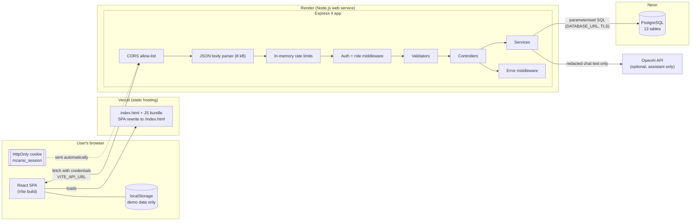
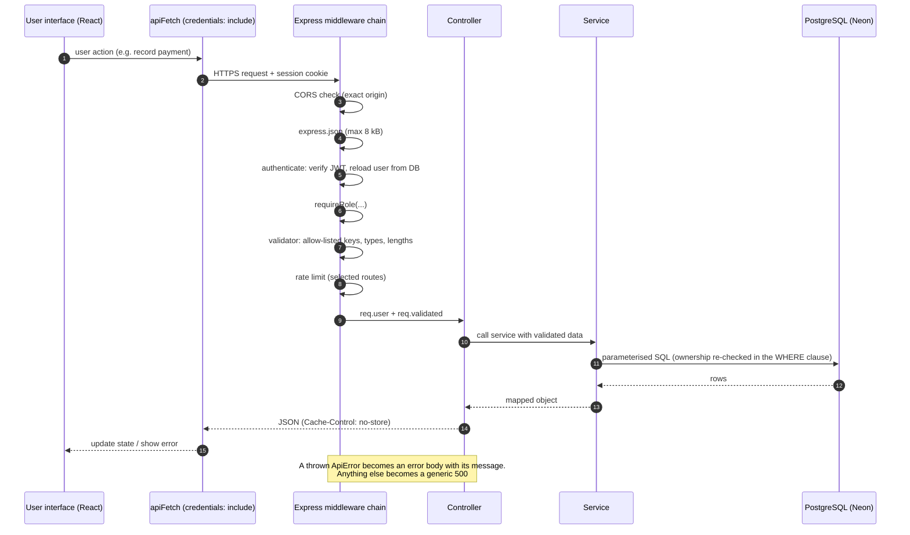
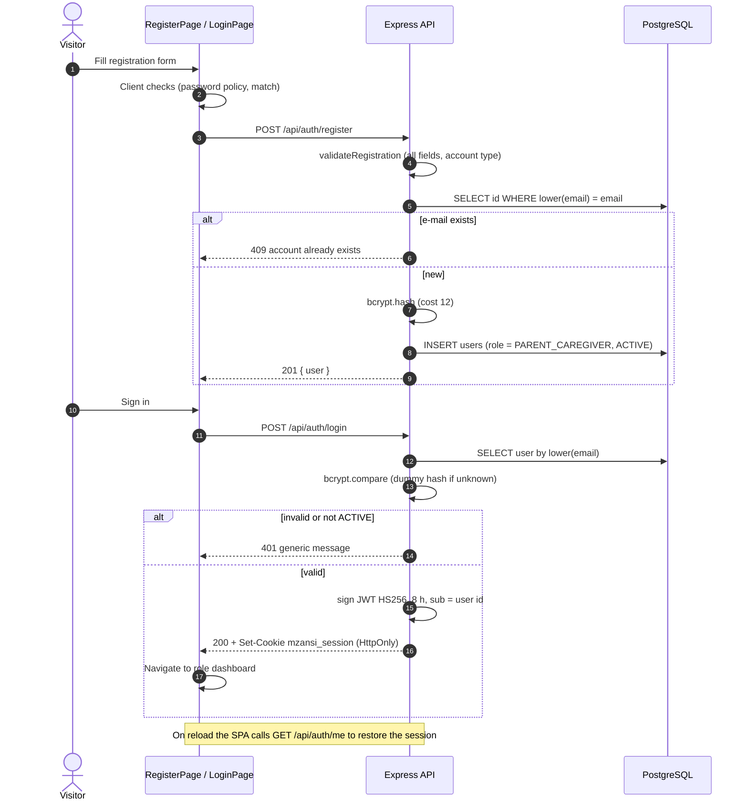
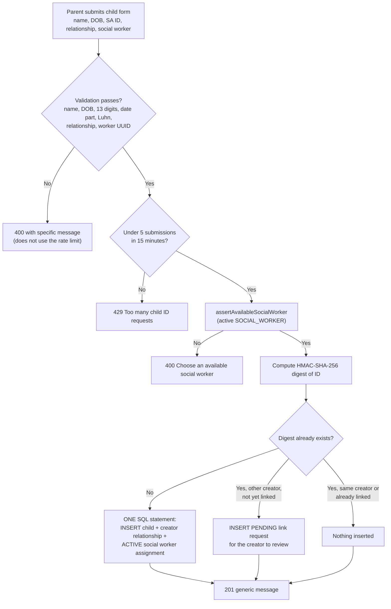
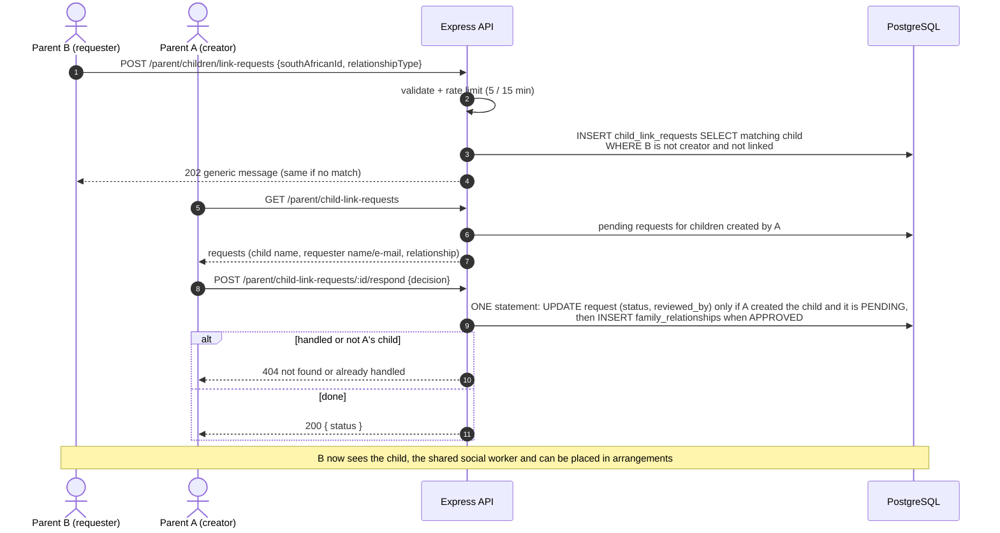
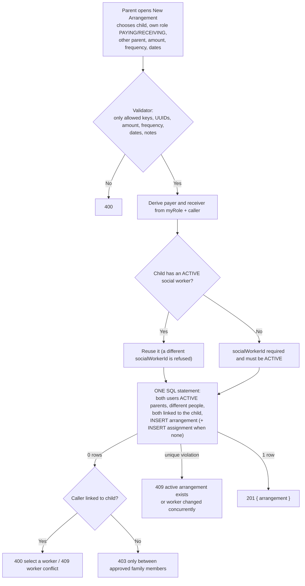
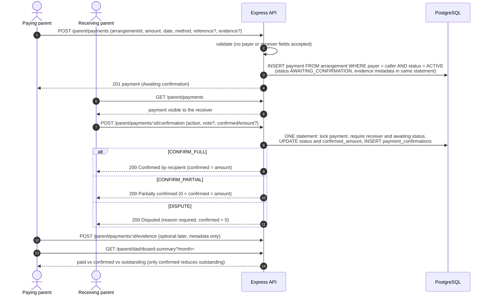
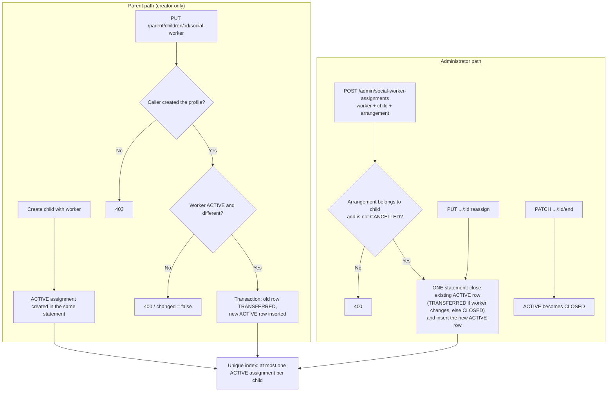
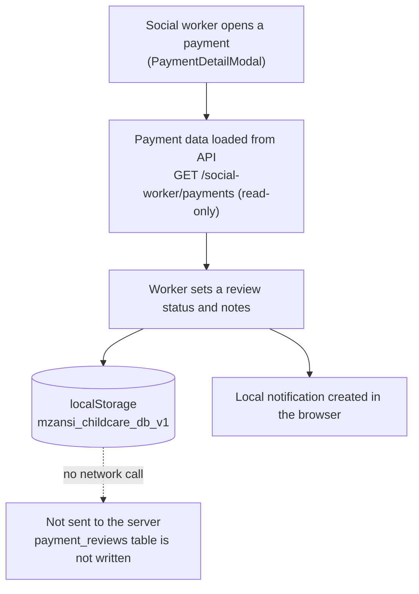
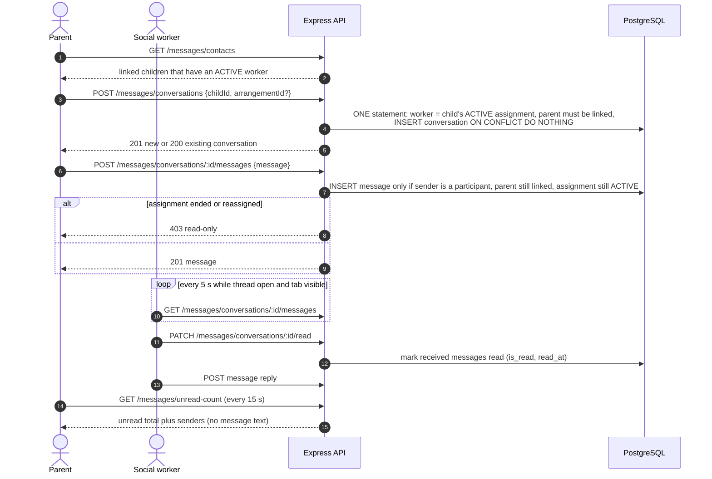

# Mzansi ChildCare — Complete System Documentation

**Project:** Mzansi ChildCare — Child Maintenance Record and Payment Tracking System
**Context:** Samsung Innovation Internship 2027 assessment, Tshimologong Digital Innovation Precinct
**Companion document:** *Mzansi ChildCare — PostgreSQL Database Design and Technical Documentation* (55 pages)
**Method:** This document was written by reading the actual source code in the repository. No source file was modified. `.env` files, database exports and files holding real identification numbers were deliberately not opened.

> **Reading guide.** Statements in this document are verified against the source unless they carry one of these labels:
> - **[Inferred]**: a conclusion drawn from the code that is not stated in it (for example a deployment command).
> - **[Not verified]**: something that could not be confirmed from the repository (for example the live production configuration).
> - **[Recommended]**: an improvement that is *not* implemented.

---

## Table of Contents

1. [Introduction](#1-introduction)
2. [System Overview](#2-system-overview)
3. [Technology Stack](#3-technology-stack)
4. [System Architecture](#4-system-architecture)
5. [Frontend Architecture](#5-frontend-architecture)
6. [Backend Architecture](#6-backend-architecture)
7. [REST API Reference](#7-rest-api-reference)
8. [User Roles and Permissions](#8-user-roles-and-permissions)
9. [Functional Modules](#9-functional-modules)
10. [Authentication and Security](#10-authentication-and-security)
11. [Data Flow and Business Workflows](#11-data-flow-and-business-workflows)
12. [Testing and Quality Assurance](#12-testing-and-quality-assurance)
13. [Deployment and Installation](#13-deployment-and-installation)
14. [System Limitations](#14-system-limitations)
15. [Future Improvements](#15-future-improvements)
16. [Conclusion](#16-conclusion)

---

## 1. Introduction

### 1.1 Purpose

Mzansi ChildCare is a web application that lets the people involved in a child's financial support keep one shared, verifiable record of that support. A parent or caregiver registers a child, links the other parent or caregiver, agrees a maintenance arrangement (an expected amount and frequency), records each payment, and the receiving parent confirms, partially confirms or disputes it. A social worker assigned to the child can see the same records and message the parents. An administrator manages social workers, assignments and families.

### 1.2 Problem addressed

Informal child maintenance in South Africa is often arranged by word of mouth, with payments made by EFT, eWallet, cash or retail money transfer. When there is a disagreement, neither parent has a neutral record of what was agreed, what was paid and what the receiving parent accepted. Mzansi ChildCare provides that record. It **tracks and records**; it does **not move money** and it is **not a court system** (no payment gateway, bank integration or legal workflow exists in the code).

### 1.3 Scope of this document

This document covers the implemented software: the React front end, the Node.js/Express back end, the PostgreSQL integration, security controls, tests, deployment configuration, and the gaps found during inspection. The database design is documented in depth in the companion 55-page PDF, so section 9 only summarises tables per module.

### 1.4 Repository layout

| Path | Contents |
|---|---|
| `frontend/` | React + TypeScript single-page application (Vite) |
| `backend/` | Express API, migrations, tests |
| `backend/src/` | `server.js` entry, `app.js` wiring, `config/`, `routes/`, `controllers/`, `services/`, `validators/`, `middleware/`, `utils/` |
| `backend/database/` | `schema.sql`, `migrations/001–007`, `rollbacks/`, `migrate.js`, `seedAdmin.js`, `seeds/demoData.sql`, `erd.mmd` |
| `backend/tests/` | 13 `*.test.js` files and `helpers/` |
| `System-Documentation/` | Database documentation (HTML/PDF) and this document |
| `README.md` | Project overview, run instructions, deployment notes |

---

## 2. System Overview

### 2.1 Users and roles

| Role (database value) | Who they are | How the account is created |
|---|---|---|
| `PARENT_CAREGIVER` | Parent, paying parent, caregiver or guardian | Public registration (`POST /api/auth/register`) |
| `SOCIAL_WORKER` | Social worker supporting a family | Created by an administrator (`POST /api/admin/social-workers`) |
| `ADMIN` | System administrator | Created from the command line (`npm run admin:seed`) |

Public registration **always** stores the role `PARENT_CAREGIVER`. The "account type" a visitor selects (`Parent / Caregiver` or `Paying Parent`) is validated but never used to choose the stored role.

### 2.2 Capabilities at a glance

| Capability | Status |
|---|---|
| Registration, login, logout, session restore | Implemented |
| Child profile creation with SA ID validation and a keyed digest | Implemented |
| Linking a second parent to an existing child, with approval by the creator | Implemented |
| Choosing and changing a child's social worker (creator only) | Implemented |
| Maintenance arrangements (create, edit terms) | Implemented |
| Payment recording by the paying parent | Implemented |
| Payment confirmation, partial confirmation, dispute by the receiving parent | Implemented |
| Payment evidence | **Partial**: file name, type and size are stored; file contents are not uploaded |
| Parent ⇄ social worker messaging (read receipts, unread counts, search) | Implemented |
| Administrator dashboard, social-worker CRUD, assignments, family management, reports | Implemented |
| Public AI assistant (OpenAI, optional) | Implemented |
| Social worker payment reviews, professional notes, concerns, notifications | **Not connected to the API**: browser `localStorage` demo data only |
| User profile editing | **Not connected to the API**: browser-only (see §14) |
| Contact form | **Not connected to the API**: the form shows a confirmation but sends nothing |

### 2.3 High-level scenario

1. A parent registers and signs in.
2. The parent creates a child profile, choosing an available social worker. The South African ID number is validated, converted to a keyed digest and **never stored**.
3. If the child already exists (same digest), the system silently files a link request for the original creator to approve, and answers identically either way so that ID numbers cannot be probed.
4. Two linked parents create a maintenance arrangement: who pays, who receives, how much, how often.
5. The paying parent records payments. The receiving parent confirms in full, confirms a partial amount, or disputes with a reason.
6. The child's social worker sees the family's children, arrangements and payments (read-only) and can message the parents.
7. An administrator supervises workers, assignments and families, and reads aggregate reports. Administrators cannot read message contents.

---

## 3. Technology Stack

### 3.1 Front end (`frontend/package.json`)

| Technology | Version | Use |
|---|---|---|
| React | ^19.0.1 | UI library |
| TypeScript | ^7.0.2 | Typing (`npm run lint` runs `tsc --noEmit`) |
| Vite | ^8.3.0 | Build tool and dev server (port 3000) |
| Tailwind CSS | ^4.3.3 (`@tailwindcss/vite`) | Styling |
| react-router-dom | ^7.18.5 | Client-side routing |
| lucide-react | ^0.546.0 | Icons |
| motion | ^12.23.24 | Animation |
| recharts | ^3.10.1 | Charts |

`@google/genai`, `express` and `dotenv` also appear in the front-end `package.json`; no source file under `frontend/src` imports `@google/genai` or references `GEMINI` (they are template leftovers; see §14).

### 3.2 Back end (`backend/package.json`)

| Technology | Use |
|---|---|
| Node.js (`engines.node >= 19`) | Runtime |
| Express 4 | HTTP framework |
| `@neondatabase/serverless` | PostgreSQL client for Neon (tagged-template queries) |
| `bcryptjs` | Password hashing |
| `jsonwebtoken` | Session tokens (HS256) |
| `openai` | Public AI assistant |
| `dotenv` | Reads `backend/.env` |
| Node built-in `node:test` | Test runner |

### 3.3 Data and hosting

| Layer | Provider / technology | Evidence |
|---|---|---|
| Database | PostgreSQL on **Neon** (serverless). PostgreSQL 15+ is required because migrations use `ON DELETE SET NULL (column)`. | `@neondatabase/serverless`, `README.md`, migrations |
| Front-end hosting | **Vercel** | `frontend/vercel.json`, `frontend/.env.example`, `README.md` |
| Back-end hosting | **Render** | `backend/.env.example`, `README.md` (no `render.yaml` exists in the repository) |
| Source control | GitHub (`Defence-Ndzhobela/mzansi_child_care`, branch `main`) | `git remote` |
| CI/CD | None in the repository (no `.github/` directory, no pipeline files) | Repository listing |

---

## 4. System Architecture

### 4.1 Component overview



### 4.2 Request/response path



### 4.3 Architectural principles evident in the code

| Principle | Where it shows |
|---|---|
| **Layered structure** (route → validator → controller → service) | `backend/src/routes`, `validators`, `controllers`, `services` |
| **Dependency injection** | `createApp({ sql, jwtSecret, … })` and every `createXService({ sql })` factory; tests inject a fake `sql` |
| **Server-side authority** | Roles are re-read from the database on every request; paying/receiving users and the social worker are derived on the server, never taken from the request body |
| **Atomic multi-step changes** | Many operations are one SQL statement using CTEs (`WITH … INSERT … UPDATE`), so they succeed or fail together |
| **Non-disclosure** | Cross-family lookups return the same "not found" / generic success so IDs and ID numbers cannot be probed |
| **Fail-fast configuration** | `loadEnv()` validates all environment variables at start-up and exits with code 1 on error |

### 4.4 External services and integrations

| Service | Purpose | Data sent | Notes |
|---|---|---|---|
| Neon PostgreSQL | System of record | All application data | TLS (`sslmode=require` in the template) |
| OpenAI | Answers questions on the public assistant | Only the visitor's chat messages, with 13-digit numbers, e-mail addresses and long digit strings redacted; system prompt; `store: false` | Optional. With no `OPENAI_API_KEY` the assistant reports it is unavailable and nothing else is affected |
| Vercel | Serves the static front end | None | |
| Render | Runs the API | None | |

There is **no** e-mail service, SMS service, payment gateway, Home Affairs/ID verification service, object/file storage provider, or WebSocket server in the code.

---

## 5. Frontend Architecture

### 5.1 Application structure

```
frontend/src/
├── main.tsx / App.tsx          Entry and router
├── config/api.ts               API_URL / BACKEND_URL (only place that reads VITE_* URLs)
├── services/                   apiClient.ts, adminApi.ts, messageApi.ts, assistantApi.ts, storageService.ts
├── context/                    AuthContext.tsx, DataContext.tsx
├── routes/ProtectedRoute.tsx   Role guard
├── layouts/                    PublicLayout.tsx, DashboardLayout.tsx
├── pages/                      public/, parent/, social-worker/, admin/
├── components/                 Shared UI; admin/, messages/, assistant/ sub-folders
├── hooks/                      usePolling, useMessageSummary, useAdminList, useAdminDetail, useFamilyScope
├── types/ utils/ data/         Types, formatting, role helpers, demo seed data
└── index.css                   Tailwind theme, print styles
```

**Provider nesting** (`App.tsx`): `BrowserRouter → AuthProvider → DataProvider → Routes`.

### 5.2 Pages and routes

| Route | Page | Guard | Purpose |
|---|---|---|---|
| `/` | `LandingPage` | Public | Introduction |
| `/about`, `/how-it-works` | `AboutPage`, `HowItWorksPage` | Public | Information |
| `/contact` | `ContactPage` | Public | Contact form (client-side only; see §14) |
| `/login` | `LoginPage` | Public | Sign in; also lists demo accounts |
| `/register` | `RegisterPage` | Public | Parent/caregiver registration |
| `/parent/dashboard` | `ParentDashboard` | `PARENT_CAREGIVER` | Monthly paying/receiving summary, pending confirmations |
| `/parent/children` | `ChildrenPage` | `PARENT_CAREGIVER` | Create/edit children, link requests, social worker choice |
| `/parent/arrangements` | `ArrangementsPage` | `PARENT_CAREGIVER` | Create/edit arrangements |
| `/parent/payments` | `PaymentsPage` | `PARENT_CAREGIVER` | Record payments, confirm/dispute |
| `/parent/history` | `ParentPaymentHistoryPage` | `PARENT_CAREGIVER` | Payment history |
| `/parent/reports` | `ParentReportsPage` | `PARENT_CAREGIVER` | Printable reports |
| `/parent/messages` | `ParentMessagesPage` → `MessagingWorkspace` | `PARENT_CAREGIVER` | Messaging |
| `/parent/profile` | `ParentProfilePage` | `PARENT_CAREGIVER` | Profile (browser-only) |
| `/social-worker/dashboard` | `SocialWorkerDashboard` | `SOCIAL_WORKER` | Caseload overview |
| `/social-worker/families` | `AssignedFamiliesPage` | `SOCIAL_WORKER` | Assigned families; professional notes (browser-only) |
| `/social-worker/children` | `SocialWorkerChildrenPage` | `SOCIAL_WORKER` | Assigned children |
| `/social-worker/payments` | `SocialWorkerPaymentRecordsPage` | `SOCIAL_WORKER` | Payment records (read-only from API) |
| `/social-worker/concerns` | `PaymentConcernsPage` | `SOCIAL_WORKER` | Payment concerns (browser-only demo data) |
| `/social-worker/reports` | `SocialWorkerReportsPage` | `SOCIAL_WORKER` | Reports |
| `/social-worker/messages` | `SocialWorkerMessagesPage` → `MessagingWorkspace` | `SOCIAL_WORKER` | Messaging |
| `/social-worker/profile` | `SocialWorkerProfilePage` | `SOCIAL_WORKER` | Profile (browser-only) |
| `/admin/dashboard` | `AdminDashboard` | `ADMIN` | Platform statistics |
| `/admin/social-workers` | `AdminSocialWorkers` | `ADMIN` | Social worker CRUD |
| `/admin/child-supporters` | `AdminChildSupporters` | `ADMIN` | Paying parents directory |
| `/admin/children` | `AdminChildren` (+ `FamilyManager`) | `ADMIN` | Children and family management |
| `/admin/maintenance-arrangements` | `AdminArrangements` | `ADMIN` | Arrangement directory |
| `/admin/assignments` | `AdminAssignments` | `ADMIN` | Assign/reassign/end assignments |
| `/admin/reports` | `AdminReports` | `ADMIN` | Summary reports |
| `*` | — | — | Redirects to `/` |

### 5.3 Reusable components

| Component | Responsibility |
|---|---|
| `Modal` | Accessible dialog (`role="dialog"`, `aria-modal`, `aria-labelledby`); closes on Escape; backdrop close only when press **and** release are on the backdrop |
| `RecordPaymentModal`, `PaymentDetailModal`, `ConfirmDisputeModal` | Payment recording, detail/evidence, confirm / partial / dispute |
| `SocialWorkerSelect` | Chooses an available social worker (names only) |
| `StatusBadge`, `SummaryCard`, `EmptyState`, `ToastBanner`, `WelcomeBanner` | Presentation primitives |
| `admin/ListFrame`, `Pagination`, `StatusPill`, `ConfirmDialog`, `ArrangementTable`, `FamilyManager` | Shared admin list/detail patterns |
| `messages/MessagingWorkspace`, `ConversationList`, `ChatThread`, `NewConversationModal`, `Avatar` | Messaging UI |
| `assistant/ChatAssistant`, `MessageText` | Floating public assistant; links limited to a fixed list of public routes |
| `AuthSplitLayout`, `GovernmentBranding`, `PhotoFrame` | Public page layout and branding |

### 5.4 Authentication state

- `AuthContext` holds the signed-in user (`id`, `fullName`, `email`, `role`) only in React memory. **The JWT is never stored by the front end** (no `localStorage` token); the session lives in the HttpOnly cookie.
- On start-up it calls `GET /auth/me`. `401` means "signed out"; other failures set a visible `sessionError`.
- `login()` posts credentials, validates the response shape (`isAuthUser`), and maps `401` to a fixed message.
- `logout()` calls `POST /auth/logout` and clears state; an error is thrown if the server call fails.
- `ProtectedRoute` checks the role locally **and** calls a role-specific endpoint (`/parent/me`, `/social-worker/me`, `/admin/me`) so the server confirms access. A `401/403` redirects to `/login`; a network error shows an alert.

### 5.5 Data state and persistence (important)

`DataContext` mixes two data sources:

| Data | Source |
|---|---|
| Children, family relationships, link requests, social workers, arrangements, payments, evidence, dashboard summary | **Backend API** (`/parent/*`, `/social-worker/*`) |
| Administrator data | **Backend API** via `adminApi.ts` |
| Messages | **Backend API** via `messageApi.ts` |
| Payment reviews, professional notes, payment concerns, notifications, profile edits | **Browser `localStorage`** key `mzansi_childcare_db_v1` (demo/seed data from `data/seedData.ts`); not sent to the server |

`storageService.saveDatabase` deliberately blanks `children`, `familyRelationships`, `arrangements`, `payments`, `evidence` and `assignments` before writing to `localStorage`, so no family or payment data is cached in the browser.

### 5.6 API communication

- `config/api.ts` exports `API_URL` (from `VITE_API_URL`, trailing slashes trimmed; defaults to same-origin `/api`) and `BACKEND_URL` (from `VITE_BACKEND_URL`). Only public values are read; every `VITE_` variable is bundled into the browser.
- `services/apiClient.ts` exposes `apiFetch(path, init)` = `fetch(API_URL + path, { credentials: 'include', ...init })`. Every API call in the application goes through it (verified by searching for `fetch(`).
- `adminApi.ts`, `messageApi.ts`, `assistantApi.ts` wrap `apiFetch`, parse JSON defensively and surface the server's `{ error }` message.
- **Polling** (no WebSockets): open chat thread every 5 s, conversation list every 10 s, unread summary every 15 s; polling pauses when the tab is hidden and resumes when it is visible (`usePolling`).

### 5.7 Form validation (client side)

Client checks improve usability; the server repeats and enforces all of them.

| Form | Client checks |
|---|---|
| Registration | Required fields, `maxLength` 150/255/30, password ≥ 10 characters, ≤ 72 bytes, upper-case + lower-case + digit, confirmation match |
| Login | Required fields; server maps failures to a fixed message |
| Contact | Required fields and `@` in e-mail (nothing is submitted) |
| Child / link / arrangement / payment forms | Validation inside page components and modals before calling `DataContext` |

### 5.8 Error handling

- API error bodies `{ "error": "…" }` are surfaced to the user through `ToastBanner` or inline `role="alert"` messages.
- Network failures produce fixed, non-technical messages ("Unable to reach the login server…").
- Loading and error states exist per data group (`childrenLoading/Error`, `maintenanceLoading/Error`, `socialWorkersError`).
- Responses that arrive after the user changed, or after a newer request started, are ignored (`maintenanceRequest` counter, `authVersion`).

### 5.9 Role-specific interfaces

`DashboardLayout` builds the navigation from the signed-in role (parent: 8 items; social worker: 8; administrator: 7). It shows an unread-message indicator for roles that can message and provides a sign-out button. Social workers see **only** assigned children, arrangements and payments because the API filters them; the UI adds no extra trust.

### 5.10 Responsive design and accessibility (measured from the source)

| Feature | Evidence |
|---|---|
| Responsive layout | Tailwind breakpoint classes (`sm:`/`md:`/`lg:`/`xl:`) used 113 times; `<meta name="viewport">` set; dashboard sidebar becomes an off-canvas drawer below `lg`; public navigation collapses to a mobile menu below `md` |
| Language | `<html lang="en-ZA">` |
| Labels | 80 `htmlFor` associations; `autoComplete` attributes on authentication fields |
| ARIA | 72 `aria-*` attributes; `aria-label` on navigation landmarks and icon buttons; dialogs use `role="dialog"` |
| Live regions | 39 `role="alert"` / `role="status"` / `aria-live` usages for errors and status |
| Keyboard | Escape closes `Modal` and minimises the assistant; the assistant moves focus to its input and returns it to the launcher; visible `focus` styles (68 usages) |
| Print | `@media print` rules hide `.no-print` elements for report pages |

**Not verified / not present:** `Modal` has no focus trap (only Escape handling); no automated accessibility audit is present in the repository.

---

## 6. Backend Architecture

### 6.1 Entry point and start-up

`backend/server.js`:

1. `loadEnv()` reads `backend/.env` (existing process variables take precedence) and validates everything; on error it logs the message and exits with code 1.
2. `createApp({ sql, jwtSecret, secureCookies, cookieSameSite, allowedOrigins, trustProxy, … AI config })` builds the Express app.
3. It listens on `env.port` (and `env.host` if `HOST` is set).
4. On `SIGINT`/`SIGTERM` it closes the server gracefully, with a 10-second forced exit.

### 6.2 Configuration (`src/config/env.js`)

| Variable | Required | Rule |
|---|---|---|
| `DATABASE_URL` | Yes | Must be set (migrations require only this) |
| `JWT_SECRET` | Yes | ≥ 32 bytes |
| `FRONTEND_URL`, `BACKEND_URL` | Yes | Must be http(s) **origins**: no credentials, path, query or fragment; **https required when `NODE_ENV=production`** |
| `NODE_ENV` | No | `development` (default), `production` or `test` |
| `PORT` | No | Integer 1–65535, default 5000 (Render supplies its own) |
| `CORS_ORIGINS` | No | Comma-separated exact origins; `*` is rejected |
| `COOKIE_SAME_SITE` | No | `strict` (default), `lax`, `none`; `none` requires an https `BACKEND_URL` |
| `TRUST_PROXY` | No | `true` enables `trust proxy = 1` (needed behind Render so rate limits see real IPs) |
| `HOST` | No | Unset means all interfaces (required on Render) |
| `OPENAI_API_KEY`, `OPENAI_MODEL` | No | Assistant is "unavailable" without a key; default model `gpt-4o-mini` |
| `ADMIN_EMAIL`, `ADMIN_PASSWORD`, `ADMIN_NAME` | Only for `admin:seed` | Read from the process environment |

Error messages name the variable but never echo its value. Secure cookies are enabled when `isProduction` **or** `COOKIE_SAME_SITE=none`. The allow-list is `FRONTEND_URL ∪ BACKEND_URL ∪ CORS_ORIGINS`.

### 6.3 Middleware order (`src/app.js`)

1. `x-powered-by` disabled
2. `trust proxy` (optional)
3. CORS (exact-origin allow-list)
4. `express.json({ limit: "8kb" })`
5. `Cache-Control: no-store` for everything under `/api`
6. Routers (see §7)
7. Error middleware (last)

### 6.4 Route organisation

| Mount prefix | Router | Access |
|---|---|---|
| `/` (GET only) | inline | Public: returns the PostgreSQL `version()` as plain text |
| `/api` | `authRoutes` | Register/login/logout public; `/auth/me`, `/parent/me`, `/social-worker/me` authenticated |
| `/api/parent/children` | `childRoutes` | `PARENT_CAREGIVER` |
| `/api/parent` | `familyRoutes`, `arrangementRoutes`, `assignmentRoutes`, `paymentRoutes` | `PARENT_CAREGIVER` |
| `/api/admin` | `adminRoutes` | `ADMIN` (single `router.use(authenticate, requireRole("ADMIN"))`) |
| `/api/ai` | `aiRoutes` | Public, rate limited |
| `/api/messages` | `messageRoutes` | `PARENT_CAREGIVER` or `SOCIAL_WORKER` |
| `/api/social-worker` | `socialWorkerRoutes` | `SOCIAL_WORKER` |

### 6.5 Controllers, services, validators

| Layer | Responsibility | Files |
|---|---|---|
| Validators | Check types, lengths, formats and **allow-listed keys** (`hasOnlyAllowedKeys`); build `req.validated`. Unknown fields are rejected so clients cannot inject `payingUserId`, `senderId`, `role`, etc. | `validators/*.js` |
| Controllers | HTTP only: read `req.validated`/`req.user`, call a service, choose the status code | `controllers/*.js` |
| Services | All SQL and business rules | `services/*.js` (auth, child, family, arrangement, assignment, payment, message, ai, adminSocialWorker, adminAssignment, adminDirectory, adminFamily) |
| Utilities | `apiResponse` (`ApiError`), `validationHelpers` (`isUuid`, `isIsoDate`, `isPlainText`, `hasControlCharacters`, `hasOnlyAllowedKeys`), `money` (cents arithmetic, max R 1,000,000), `pagination` (clamped page/size/search with LIKE escaping), `paymentSummary`, `encryptIdNumber`, `relationshipTypes`, `maintenanceLabels` | `utils/*.js` |

### 6.6 Authentication and authorization middleware

- `authMiddleware` takes a `Bearer` token **or** the `mzansi_session` cookie, calls `authService.authenticateToken`, and attaches `req.user`. Missing token → `401 "Authentication required."`.
- `authenticateToken` verifies the HS256 JWT, requires a UUID `sub`, then **re-reads the user** from the database and rejects non-`ACTIVE` accounts or unsupported roles. A role change or deactivation therefore applies immediately, even to existing tokens.
- `requireRole(role)` / `requireAnyRole(...)` return `403 "Access denied."`.

### 6.7 Database connection

`config/database.js` creates `neon(databaseUrl)`. Every query is a tagged template, so all values are sent as bound parameters (the SQL-injection defence). Multi-statement atomic work uses `sql.transaction([...])` (social worker change) or a single CTE statement.

### 6.8 File uploads

There are **no file-upload endpoints**. The API accepts only JSON (8 kB limit) and stores evidence *metadata* (`fileName`, `fileType`, `fileSizeLabel`, `description`). The stored `storage_key` is the placeholder `metadata-only/<paymentId>/<fileName>`. Accepted types are `image/*` or `application/pdf`; file names are stripped of `\` and `/`, limited to 255 characters and rejected if they contain control characters. See §14.

### 6.9 Error handling

`ApiError(status, message)` messages are safe to show and are returned as `{ "error": message }`. Malformed JSON and oversized bodies return `"Invalid request body."`. Anything else returns `500 "Server error. Please try again later."` and logs only the fixed text `"Backend request failed."` (no error object, so personal data is never written to logs).

### 6.10 How a typical request is processed — worked example

*"A paying parent records a R 1,000 payment"* → `POST /api/parent/payments`:

1. CORS accepts the browser's origin; the 8 kB JSON body is parsed.
2. `authenticate` verifies the cookie JWT and loads the user; `requireRole("PARENT_CAREGIVER")` passes.
3. `validateRecordPayment` rejects unknown keys (e.g. `payingUserId`), validates the arrangement UUID, amount (positive, ≤ 2 decimals, ≤ R 1,000,000), date (valid and not after tomorrow UTC), method (one of five codes), reference (≤ 120 characters, no control characters) and optional evidence metadata.
4. `paymentService.recordPayment` runs one CTE statement that inserts the payment **only if** the arrangement is `ACTIVE` and `paying_user_id` equals the caller; the paying user, receiving user and child are copied from the arrangement. Evidence metadata is inserted in the same statement.
5. If no row was created, the service explains why without leaking: `404` (not a party), `403` (not the payer), or `409` (arrangement not active).
6. The controller returns `201 { payment }`.

---

## 7. REST API Reference

### 7.1 Conventions

| Item | Value |
|---|---|
| Base URL | `{BACKEND_URL}/api` (the front end calls it through `VITE_API_URL`) |
| Format | JSON request and response bodies. Requests larger than 8 kB are rejected |
| Authentication | HttpOnly cookie `mzansi_session` (set by login). An `Authorization: Bearer <jwt>` header is also accepted by the middleware |
| Error body | `{ "error": "Human readable message" }` |
| Caching | All `/api` responses carry `Cache-Control: no-store` |
| Versioning | None |
| IDs | UUIDs. A malformed UUID in a URL returns `404` (not `400`) so the response does not distinguish "bad" from "unknown" |
| Money | Rand (ZAR) as a JSON number with at most 2 decimals; `> 0` and `≤ 1,000,000` |
| Dates | `YYYY-MM-DD` (calendar-checked) |
| Common errors | `401 Authentication required.` / `401 Session expired or invalid.`, `403 Access denied.`, `400 Invalid request body.` (malformed JSON), `403 Origin not allowed.` (CORS), `429` (rate limits), `500 Server error. Please try again later.` |

**Relationship type codes** accepted wherever a relationship is chosen (case-insensitive; spaces and hyphens become `_`): `MOTHER`, `FATHER`, `PRIMARY_CAREGIVER`, `PAYING_PARENT`, `LEGAL_GUARDIAN`, `EXTENDED_FAMILY_CAREGIVER`.

**Payment methods:** `EFT_BANK_TRANSFER`, `E_WALLET_INSTANT_MONEY`, `CASH_WITH_RECEIPT`, `RETAIL_MONEY_TRANSFER`, `OTHER`.
**Frequencies:** `MONTHLY`, `FORTNIGHTLY`, `WEEKLY`. **Arrangement statuses:** `ACTIVE`, `PAUSED`, `COMPLETED`, `CANCELLED` (parents may set only `ACTIVE`, `PAUSED`, `COMPLETED`).
**Payment statuses:** `SUBMITTED`, `AWAITING_CONFIRMATION`, `CONFIRMED_BY_RECIPIENT`, `PARTIALLY_CONFIRMED`, `DISPUTED`. Responses return the **labels** (e.g. `"Awaiting confirmation"`).

All examples below use fictitious names, UUIDs and values.

### 7.2 Endpoint index

| # | Method | Path | Access |
|---|---|---|---|
| 1 | POST | `/api/auth/register` | Public |
| 2 | POST | `/api/auth/login` | Public |
| 3 | POST | `/api/auth/logout` | Public |
| 4 | GET | `/api/auth/me` | Any signed-in user |
| 5 | GET | `/api/parent/me` | Parent |
| 6 | GET | `/api/social-worker/me` | Social worker |
| 7 | GET | `/api/parent/children` | Parent |
| 8 | POST | `/api/parent/children` | Parent |
| 9 | PATCH | `/api/parent/children/:childId` | Parent (creator) |
| 10 | POST | `/api/parent/children/link-requests` | Parent |
| 11 | GET | `/api/parent/child-link-requests` | Parent (creator) |
| 12 | POST | `/api/parent/child-link-requests/:requestId/respond` | Parent (creator) |
| 13 | GET | `/api/parent/social-workers` | Parent |
| 14 | PUT | `/api/parent/children/:childId/social-worker` | Parent (creator) |
| 15 | GET | `/api/parent/arrangements` | Parent |
| 16 | POST | `/api/parent/arrangements` | Parent |
| 17 | PATCH | `/api/parent/arrangements/:arrangementId` | Parent (party) |
| 18 | GET | `/api/parent/payments` | Parent |
| 19 | POST | `/api/parent/payments` | Parent (payer) |
| 20 | POST | `/api/parent/payments/:paymentId/evidence` | Parent (payer) |
| 21 | POST | `/api/parent/payments/:paymentId/confirmation` | Parent (receiver) |
| 22 | GET | `/api/parent/dashboard-summary` | Parent |
| 23 | GET | `/api/social-worker/children` | Social worker |
| 24 | GET | `/api/social-worker/arrangements` | Social worker |
| 25 | GET | `/api/social-worker/payments` | Social worker |
| 26–34 | various | `/api/messages/*` (9 endpoints) | Parent or social worker |
| 35 | POST | `/api/ai/chat` | Public (rate limited) |
| 36–58 | various | `/api/admin/*` (23 endpoints) | Admin |
| — | GET | `/` | Public (database version) |

In total the API registers **58** endpoints under `/api` plus the root health/version route.

### 7.3 Authentication module

#### POST `/api/auth/register`
- **Purpose:** Create a parent/caregiver account. **Auth:** none. **Role:** none (always creates `PARENT_CAREGIVER`).
- **Body (all required):**

| Field | Rule |
|---|---|
| `fullName` | String, trimmed non-empty, ≤ 150, no control characters |
| `email` | String ≤ 255 matching `x@y.z`; stored lower-case |
| `phone` | String ≤ 30 matching `^\+?[0-9 ()-]{7,30}$` with ≥ 7 digits |
| `password` | ≥ 10 characters, ≤ 72 bytes, contains a-z, A-Z and 0-9 |
| `confirmPassword` | Must equal `password` |
| `accountType` | `PARENT_CAREGIVER` or `PAYING_PARENT` (not used to choose the role) |

```http
POST /api/auth/register
Content-Type: application/json

{ "fullName": "Thandi Example", "email": "thandi@example.test", "phone": "+27 82 000 0000",
  "password": "Example#Pass1", "confirmPassword": "Example#Pass1", "accountType": "PARENT_CAREGIVER" }
```
```json
201 Created
{ "user": { "id": "11111111-1111-4111-8111-111111111111", "fullName": "Thandi Example",
            "email": "thandi@example.test", "role": "PARENT_CAREGIVER" } }
```
- **Errors:** `400` with one of: "Enter a valid full name (up to 150 characters).", "Enter a valid email address.", "Enter a valid phone number.", "Password must be at least 10 characters and include uppercase, lowercase and a number (maximum 72 bytes).", "Passwords do not match.", "Select a valid account type."; `409 "An account with this email address already exists."` (also returned when two requests race on the unique e-mail constraint).
- **Security:** bcrypt cost 12; hash never returned.

#### POST `/api/auth/login`
- **Purpose:** Sign in. **Auth:** none.
- **Body:** `email` (string, non-empty, ≤ 255), `password` (string, non-empty, ≤ 72 bytes).
- **Success `200`:** `{ "token": "<jwt>", "user": { id, fullName, email, role } }` plus `Set-Cookie: mzansi_session=<jwt>; HttpOnly; Path=/; Max-Age=28800; SameSite=<strict|lax|none>; Secure` (`Secure` when production or `SameSite=None`).
- **Errors:** `400 "Enter a valid email and password."`; `401 "Invalid email or password, or account unavailable."` (same message for unknown e-mail, wrong password and non-`ACTIVE` accounts; a dummy bcrypt hash is compared for unknown e-mails to equalise timing).
- **Note:** the JWT is returned in the body as well as the cookie; the front end ignores the body token.

#### POST `/api/auth/logout`
- **Purpose:** Clear the session cookie. **Auth:** none (works without a valid session). **Success:** `204 No Content`. The JWT itself is not revoked (see §14).

#### GET `/api/auth/me`, `/api/parent/me`, `/api/social-worker/me`
- **Purpose:** Return the signed-in user; the role-specific variants additionally confirm the role (used by `ProtectedRoute`). `/api/admin/me` is the administrator equivalent.
- **Success `200`:** `{ "user": { "id", "fullName", "email", "role" } }`. **Errors:** `401`, `403` (wrong role on the role-specific routes).

### 7.4 Child profiles, linking and social worker choice (parent)

#### GET `/api/parent/children`
- **Purpose:** Children the caller created or is linked to (not archived). **Success `200`:**
```json
{ "children": [ {
  "id": "c0000000-0000-4000-8000-000000000001", "firstName": "Lwazi", "lastName": "Example",
  "dateOfBirth": "2019-05-14", "createdBy": "11111111-1111-4111-8111-111111111111",
  "createdAt": "2026-03-01T08:00:00.000Z", "updatedAt": "2026-03-01T08:00:00.000Z",
  "socialWorker": { "id": "88888888-8888-4888-8888-888888888801", "fullName": "Sipho Worker" },
  "relationships": [ { "id": "…", "childId": "c0000000-…", "userId": "1111…", "fullName": "Thandi Example",
                       "email": "thandi@example.test", "relationshipType": "Mother",
                       "isPrimaryCaregiver": true, "createdAt": "…" } ] } ] }
```
The ID number or its digest is **never** returned.

#### POST `/api/parent/children`
- **Purpose:** Create a child, or — if the ID number matches an existing child — silently file a link request. **Rate limit:** 5 accepted submissions per user per 15 minutes → `429 "Too many child ID requests. Try again later."` (invalid submissions do not count because validation runs first).
- **Body (all required):**

| Field | Rule |
|---|---|
| `firstName`, `lastName` | Non-empty after trim, ≤ 100, no control characters |
| `dateOfBirth` | `YYYY-MM-DD`, real calendar date, not in the future |
| `southAfricanId` | 13 digits (spaces removed); valid `YYMMDD` date; Luhn check digit passes |
| `relationshipType` | One of the six relationship codes |
| `isPrimaryCaregiver` | Boolean |
| `socialWorkerId` | UUID of an existing, `ACTIVE` social worker |

```json
201 Created
{ "message": "Profile submitted. If an existing child profile matches, its creator must approve access." }
```
- **Errors:** `400` ("Enter a valid first and last name.", "Enter a valid date of birth that is not in the future.", "Enter a valid 13-digit South African ID number.", "Choose a valid relationship and caregiver status.", "Select an available social worker."); `429`.
- **Business rules:** the response is identical whether a child was created or a link request was filed. The ID is stored only as an HMAC-SHA-256 digest. A child, its creator relationship and its `ACTIVE` assignment are created in one statement.

#### PATCH `/api/parent/children/:childId`
- **Purpose:** Edit a child's name/date of birth. **Only the creator** (`WHERE created_by = caller`). **Body:** `firstName`, `lastName`, `dateOfBirth` (same rules). **Success `200`:** `{ "child": { … } }` (relationships array empty in this response). **Errors:** `404 "Child profile not found."` (bad UUID) or `404 "Child profile not found or you cannot edit it."`; `400 "Enter a valid name and date of birth."`.

#### POST `/api/parent/children/link-requests`
- **Purpose:** Ask to be linked to an existing child by ID number. **Rate limit:** shares the 5-per-15-minutes limit above.
- **Body:** `southAfricanId` (valid as above), `relationshipType`.
- **Success `202`:** `{ "message": "If a matching profile can be identified, its creator will receive a linking request for review." }` — returned whether or not a match exists. A request is created only if a child matches, the caller is not its creator, and the caller is not already linked (`ON CONFLICT DO NOTHING` for duplicates).
- **Errors:** `400 "Enter a valid South African ID and relationship."`; `429`.

#### GET `/api/parent/child-link-requests`
- **Purpose:** Pending requests for children **the caller created**. **Success `200`:**
```json
{ "requests": [ { "id": "r0000000-…", "childId": "c0000000-…", "childName": "Lwazi Example",
  "requesterId": "2222…", "requesterName": "Sibusiso Example", "requesterEmail": "sibusiso@example.test",
  "relationshipType": "Father", "requestedAt": "2026-03-02T10:00:00.000Z" } ] }
```

#### POST `/api/parent/child-link-requests/:requestId/respond`
- **Purpose:** Approve or reject. **Body:** `{ "decision": "APPROVED" | "REJECTED" }`. **Success `200`:** `{ "status": "APPROVED" }`. On approval a `family_relationships` row (non-primary) is created in the same statement.
- **Errors:** `400 "Choose approve or reject for a valid linking request."`; `404 "Linking request not found or already handled."` (also returned when the caller is not the child's creator).

#### GET `/api/parent/social-workers`
- **Purpose:** Active social workers a parent may choose (names only, no contact details). **Success `200`:** `{ "socialWorkers": [ { "id": "…", "fullName": "Sipho Worker" } ] }`.

#### PUT `/api/parent/children/:childId/social-worker`
- **Purpose:** Assign or replace the child's social worker. **Only the profile creator.** **Body:** `{ "socialWorkerId": "<uuid>" }` (no other keys). **Success `200`:** `{ "changed": true|false, "child": { … } }`.
- **Rules:** the previous assignment is set to `TRANSFERRED` and a new `ACTIVE` one inserted in one transaction (history is kept). Choosing the current worker returns `changed:false`.
- **Errors:** `400 "Select an available social worker."` / `"Choose an available social worker."`; `403 "Only the person who created this child profile can change the social worker."`; `404 "Child profile not found."`; `409` (concurrent change).

### 7.5 Maintenance arrangements (parent)

#### GET `/api/parent/arrangements`
- **Purpose:** Arrangements where the caller pays or receives. **Success `200`:**
```json
{ "arrangements": [ { "id": "a0000000-…", "childId": "c0000000-…", "payingUserId": "1111…", "receivingUserId": "2222…",
  "payerName": "Thandi Example", "receiverName": "Sibusiso Example", "myRole": "PAYING",
  "expectedAmount": 1500, "currency": "ZAR", "frequency": "Monthly", "startDate": "2026-03-01",
  "status": "Active", "notes": "Paid on the 1st",
  "socialWorker": { "id": "8888…", "fullName": "Sipho Worker" },
  "createdAt": "…", "updatedAt": "…" } ] }
```
(`endDate` and `notes` are omitted when empty; `myRole` is relative to the caller.)

#### POST `/api/parent/arrangements`
- **Body** (only these keys): `childId` (UUID), `myRole` (`PAYING`|`RECEIVING`), `otherUserId` (UUID), `expectedAmount` (number), `frequency`, `startDate`, optional `endDate` (≥ `startDate`), optional `notes` (plain text ≤ 500), optional `socialWorkerId` (UUID).
- **Success `201`:** `{ "arrangement": { … } }`.
- **Rules:** the payer and receiver are derived from `myRole` and the caller, never from free fields; both must be `ACTIVE` parents **and** approved family members of the child; they must differ; one `ACTIVE` arrangement per payer/receiver/child pair (unique index). If the child already has a social worker it is reused; otherwise `socialWorkerId` is required and assigned in the same statement.
- **Errors:** `400` ("Check the arrangement details and try again." for unknown keys; "Choose a child, your role and the other parent or caregiver."; "Expected amount must be a positive amount in rand (maximum R 1,000,000)."; "Choose a valid frequency."; "Enter a valid start date."; "The end date must be a valid date on or after the start date."; "Notes must be plain text of up to 500 characters."; "Select an available social worker."; "Select an available social worker for this child."); `403 "Arrangements can only be created between you and another approved family member of this child."`; `409` (duplicate active arrangement, or the child's social worker already set differently / changed concurrently).

#### PATCH `/api/parent/arrangements/:arrangementId`
- **Body** (only these keys): `expectedAmount`, `frequency`, `startDate`, `endDate`, `status` (`ACTIVE|PAUSED|COMPLETED`), `notes`. **Success `200`:** `{ "arrangement": { … } }`.
- **Rules:** either party may edit terms; the child, payer and receiver can never change. **Errors:** `404 "Maintenance arrangement not found."`; `400 "Choose a valid status."` and the term messages above; `409` duplicate active arrangement.

### 7.6 Payments (parent)

#### GET `/api/parent/payments`
- **Success `200`:** `{ "payments": [ … ] }` — payments the caller made or received, newest first.
```json
{ "payments": [ { "id": "p0000000-…", "arrangementId": "a0000000-…", "childId": "c0000000-…",
  "payingUserId": "1111…", "receivingUserId": "2222…", "payerName": "Thandi Example", "receiverName": "Sibusiso Example",
  "amount": 1000, "confirmedAmount": 500, "currency": "ZAR", "paymentDate": "2026-03-05",
  "paymentMethod": "EFT Bank Transfer", "paymentReference": "REF-9F3A21C0", "status": "Partially confirmed",
  "recipientNote": "Only R500 received", "createdAt": "…", "updatedAt": "…",
  "evidence": [ { "id": "e000…", "paymentId": "p000…", "uploadedBy": "1111…", "fileName": "proof.pdf",
                  "fileType": "application/pdf", "fileSizeLabel": "120 KB", "description": "", "uploadedAt": "…" } ] } ] }
```
`disputeReason` replaces `recipientNote` when the decision is a dispute. `confirmedAmount` is omitted until decided.

#### POST `/api/parent/payments`
- **Body** (only these keys): `arrangementId` (UUID), `amount` (number), `paymentDate` (valid date, not after tomorrow UTC), `paymentMethod` (code), optional `paymentReference` (≤ 120 chars, no control characters; if empty the server generates `REF-XXXXXXXX`), optional `evidence` object `{ fileName, fileType, fileSizeLabel, description? }`.
- **Success `201`:** `{ "payment": { … } }` with status `Awaiting confirmation`.
- **Errors:** `400` ("Check the payment details and try again.", "Choose a valid maintenance arrangement.", "Enter a valid payment amount greater than R 0.00.", "Enter a valid payment date that is not in the future.", "Choose a valid payment method.", "The payment reference must be plain text of up to 120 characters.", "The evidence details are not valid."); `403 "Only the paying parent can record a payment for this arrangement."`; `404 "Maintenance arrangement not found."`; `409 "Payments can only be recorded against an active arrangement."`.

#### POST `/api/parent/payments/:paymentId/evidence`
- **Body:** `{ fileName, fileType, fileSizeLabel, description? }` — `fileType` must be `image/*` or `application/pdf`; `fileSizeLabel` ≤ 30; `description` ≤ 500. **Metadata only; no file bytes are accepted.**
- **Success `201`:** `{ "payment": { … } }`. **Errors:** `400 "The evidence details are not valid."`; `403 "Only the paying parent can attach evidence to this payment."`; `404 "Payment not found."`.

#### POST `/api/parent/payments/:paymentId/confirmation`
- **Purpose:** The **receiving** parent decides. **Body** (only these keys): `action` (`CONFIRM_FULL|CONFIRM_PARTIAL|DISPUTE`), `note` (plain text ≤ 1000; **required** for `DISPUTE`), `confirmedAmount` (**required** for `CONFIRM_PARTIAL`, must be `> 0` and `< amount`; rejected for other actions).
- **Success `200`:** `{ "payment": { … } }` (status `Confirmed by recipient`, `Partially confirmed` or `Disputed`).
- **Rules:** a payment can be decided **once**, and only while `AWAITING_CONFIRMATION`/`SUBMITTED`; the check, status update and `payment_confirmations` insert are one statement (`FOR UPDATE`).
- **Errors:** `400` ("Choose to confirm, partially confirm or dispute this payment.", "Enter the partial amount received, greater than R 0.00.", "A confirmed amount can only be given when partially confirming.", "Please provide a clear reason for disputing this payment.", "The note must be plain text of up to 1000 characters.", "The partial amount must be more than R 0.00 and less than the recorded amount."); `403 "Only the receiving parent can confirm or dispute this payment."`; `404 "Payment not found."`; `409 "This payment has already been confirmed or disputed."`.

#### GET `/api/parent/dashboard-summary?month=YYYY-MM`
- **Query:** `month` optional, `^\d{4}-(0[1-9]|1[0-2])$` (default: current month in `Africa/Johannesburg`). **Error:** `400 "Choose a valid month such as 2026-11."`.
- **Success `200`:**
```json
{ "summary": { "month": "2026-03",
  "paying": { "arrangementCount": 1, "expectedAmount": 1500, "paidAmount": 1000, "confirmedAmount": 500,
              "outstandingAmount": 1000, "awaitingConfirmation": { "count": 0, "amount": 0 }, "disputed": { "count": 0, "amount": 0 } },
  "receiving": null,
  "arrangements": [ { "arrangementId": "a000…", "childId": "c000…", "role": "PAYING", "counterpartyName": "Sibusiso Example",
                      "expectedAmount": 1500, "paidAmount": 1000, "confirmedAmount": 500, "outstandingAmount": 1000,
                      "awaitingConfirmationCount": 0 } ] } }
```
- **Rules:** paying and receiving totals are kept separate; only **confirmed** amounts reduce what is outstanding; expected amounts are scaled to a month (weekly × 4, fortnightly × 2); only `ACTIVE` arrangements overlapping the month expect money.

### 7.7 Social worker read-only endpoints

| Method / path | Returns | Scope rule |
|---|---|---|
| GET `/api/social-worker/children` | `{ "children": [ … ] }` | Children with an `ACTIVE` assignment to the caller |
| GET `/api/social-worker/arrangements` | `{ "arrangements": [ … ] }` | Arrangements of those children |
| GET `/api/social-worker/payments` | `{ "payments": [ … ] }` | Payments of those children |

Response shapes match the parent equivalents. There are **no write endpoints** for social workers (no reviews, notes or concerns).

### 7.8 Messaging (parent and social worker)

Conversations are private between one parent and the social worker **actively assigned** to the child. Administrators have no route to message content (`403`). Every statement re-checks the caller's membership, the family link and the assignment.

| Method / path | Purpose | Details |
|---|---|---|
| GET `/api/messages/unread-count` | Notification summary | `{ "unreadCount": 3, "conversations": [ { conversationId, childName, senderName, unreadCount, lastMessageAt } ] }` (max 10 listed; no message text) |
| GET `/api/messages/contacts` | Who can be messaged | `{ "contacts": [ { childId, childName, parent:{id,fullName}, socialWorker:{id,fullName}, conversationId|null, arrangements:[{id,expectedAmount,frequency,status}] } ] }` |
| GET `/api/messages/conversations` | List own conversations | Query: `search` (plain text ≤ 100, matches child, parent, worker names and message text, case-insensitive), `childId` (UUID), `unread` (`true`/`false`); `400` on invalid values |
| POST `/api/messages/conversations` | Start (or reuse) a conversation | Body: `childId` (UUID), `arrangementId?` (UUID), `parentUserId?` (**required for social workers**, must equal own ID if sent by a parent). `201` new / `200` existing: `{ "conversation": { id, childId, childName, maintenanceArrangementId, parent, socialWorker, canSend, unreadCount, lastMessage, createdAt, updatedAt } }`. Rate limited (30/minute, shared with sending). Errors: `403 "This child does not have an active social worker you can message."` / `"You can only message parents of children you are actively assigned to."`, `400 "Choose one of the maintenance arrangements for this child."` |
| GET `/api/messages/conversations/:conversationId` | One conversation | `404 "Conversation not found."` for both unknown and not-yours |
| GET `/api/messages/conversations/:conversationId/messages` | Message history, oldest first within a page | Query: `limit` 1–100 (default 50), `before` (message UUID, walks backwards). `{ "messages": [ { id, conversationId, senderId, message, isRead, readAt, createdAt } ], "hasMore": true }` |
| POST `/api/messages/conversations/:conversationId/messages` | Send | Body `{ "message": "…" }` (trimmed, non-empty, plain text ≤ 2000, only the `message` key). `201 { "message": { … } }`. `403` read-only text when the worker is no longer assigned. 30/minute limit |
| PATCH `/api/messages/conversations/:conversationId/read` | Mark all received messages read | `{ "updated": 2 }` |
| PATCH `/api/messages/:messageId/read` | Mark one received message read | `{ "message": { "id", "isRead": true, "readAt" } }`; `403 "You can only mark messages sent to you as read."`; `404 "Message not found."` |

`canSend` is computed live: it is `false` after the assignment ends or the worker changes, making the conversation a **read-only history**.

### 7.9 AI assistant

#### POST `/api/ai/chat`
- **Access:** public. **Rate limits (in memory):** 20 requests per IP per 5 minutes and 300 requests per hour globally → `429`.
- **Body:** `{ "messages": [ { "role": "user"|"assistant", "content": "…" } ] }` — 1–12 messages, last must be `user`; user content ≤ 500 characters, assistant content ≤ 4000; no other keys; `system` role cannot be sent.
- **Success `200`:** `{ "reply": "…" }`. **Errors:** `400 "Enter a question of up to 500 characters."`; `503 "The assistant is not available right now. Please try again later or use the Contact page."` (no key, provider failure, empty reply); `503` busy message on provider `429`; `429`.
- **Privacy:** the last 10 messages are sent after redacting e-mail addresses, 13-digit numbers and long digit strings; the model has no database or account access; `store: false`; provider errors are not logged or echoed.

### 7.10 Administrator endpoints (`/api/admin`, ADMIN only)

A single `router.use(authenticate, requireRole("ADMIN"))` protects **all** of these. List endpoints accept `page` (default 1), `pageSize` (default 10, max 100) and `search` (≤ 100 characters, LIKE characters escaped) and return `{ items, page, pageSize, total, totalPages }`.

| Method / path | Purpose | Key rules / responses |
|---|---|---|
| GET `/me` | Confirm admin session | `{ user }` |
| GET `/dashboard/stats` | Platform counts | `{ stats: { totalUsers, socialWorkers, activeSocialWorkers, childSupporters, children, activeAssignments, activeArrangements, pendingPayments, completedPayments, disputedPayments, childrenWithoutWorker } }` |
| GET `/social-workers` | List workers | Query `status` = `ACTIVE|INACTIVE|SUSPENDED`; items include `assignedChildren` |
| POST `/social-workers` | Create worker | Body (only): `fullName`, `email`, `phone`, `registrationNumber` (optional, 3–50 chars `[A-Za-z0-9 /.-]`), `accountStatus` (`ACTIVE|INACTIVE`), `password` (same policy as registration). Role is forced to `SOCIAL_WORKER`. `201 { socialWorker }`. `409` for duplicate e-mail or registration number |
| GET `/social-workers/:id` | Detail | Adds `totalAssignments`, `professionalNotes`, `paymentReviews`, `activeAssignments[]` |
| PUT `/social-workers/:id` | Update | Same fields without password. `409` if deactivating a worker who still has active cases |
| DELETE `/social-workers/:id` | "Delete" | Refused (`409`) with active cases; deactivated if any history exists; hard-deleted only if nothing references the account. `{ outcome: "DELETED" \| "DEACTIVATED" }` |
| GET `/social-worker-assignments` | Assignment list | Query `status` (`ACTIVE|CLOSED|TRANSFERRED`), `socialWorkerId`, `childId` |
| POST `/social-worker-assignments` | Assign via an arrangement | Body: `socialWorkerId`, `childId`, `arrangementId` (all UUIDs). Closes the child's existing active assignment in the same statement (`TRANSFERRED` if the worker changes, `CLOSED` if only the arrangement changes). Cancelled arrangements and mismatched child/arrangement are refused |
| PUT `/social-worker-assignments/:id` | Reassign | Body `{ socialWorkerId }`; only for an `ACTIVE` assignment |
| PATCH `/social-worker-assignments/:id/end` | End | `409 "This assignment has already ended."` if not active |
| GET `/child-supporters`, `/child-supporters/:id` | Parents who pay in an arrangement or are linked as `PAYING_PARENT` | Detail lists children and arrangements; monthly expected amount |
| GET `/children`, `/children/:id` | Child directory/detail | The ID digest is never selected; detail includes parents, arrangements, current assignment and history |
| PUT `/children/:id` | Edit child | `firstName`, `lastName`, `dateOfBirth`; refused for archived families |
| POST `/children/:id/family` | Link an existing parent by e-mail | Body: `email`, `relationshipType`, `isPrimaryCaregiver`. Never creates accounts. `404` if no active parent has that e-mail; `409` duplicate |
| PUT `/children/:id/family/:relationshipId` | Change relationship | `relationshipType`, `isPrimaryCaregiver` |
| DELETE `/children/:id/family/:relationshipId` | Remove a family member | Refused if the person is in a live arrangement for the child, or is the only family member |
| DELETE `/children/:id` | **Archive** the family (soft) | Links removed, active assignment closed, live arrangements cancelled, pending link requests rejected; accounts, payments, evidence, confirmations and messages remain. `{ outcome: "ARCHIVED" }` |
| GET `/maintenance-arrangements`, `/maintenance-arrangements/:id` | Directory/detail | Query `status` (`ACTIVE|PAUSED|COMPLETED|CANCELLED`); detail has payment counts and totals by status, never individual payments |
| GET `/reports/summary` | Reports | `{ report: { caseload[], arrangementsByStatus[], paymentsByStatus[], unassignedChildren[] (max 50) } }` |

**Example — create a social worker**
```http
POST /api/admin/social-workers
{ "fullName": "Sipho Worker", "email": "sipho.worker@example.test", "phone": "+27 11 000 0000",
  "registrationNumber": "SACSSP 10-00000", "accountStatus": "ACTIVE", "password": "Example#Pass1" }
```
```json
201 Created
{ "socialWorker": { "id": "8888…", "fullName": "Sipho Worker", "email": "sipho.worker@example.test",
  "phone": "+27 11 000 0000", "registrationNumber": "SACSSP 10-00000", "accountStatus": "ACTIVE",
  "assignedChildren": 0, "createdAt": "…", "totalAssignments": 0, "professionalNotes": 0,
  "paymentReviews": 0, "activeAssignments": [] } }
```

### 7.11 Other

| Method / path | Notes |
|---|---|
| GET `/` | Returns the PostgreSQL `version()` as `text/plain`. It doubles as a database connectivity check but is public (see §14) |

---

## 8. User Roles and Permissions

### 8.1 How roles are enforced

1. **Authentication:** `authenticate` rebuilds `req.user` from the database for every request.
2. **Role gate:** `requireRole` / `requireAnyRole` on each router (admin: one `router.use` for the whole router).
3. **Ownership gate:** services add the caller's ID to the SQL `WHERE` clause (family link, payer/receiver, active assignment, conversation membership).
4. **Front end:** `ProtectedRoute` and the role-specific menus are convenience only; every permission below is enforced by the back end.

### 8.2 Permission matrix (verified against back-end code)

✅ allowed  ❌ refused (`403`/`404`)  ◐ allowed with the restriction noted  — not applicable

| Action | Parent / Caregiver | Social Worker | Administrator |
|---|---|---|---|
| Register publicly | ✅ (creates a parent only) | ❌ (created by admin) | ❌ (created by `admin:seed`) |
| Sign in / sign out / `me` | ✅ | ✅ | ✅ |
| Create a child profile | ✅ | ❌ | ❌ |
| View children | ◐ own/linked only | ◐ actively assigned only | ◐ all, through admin API (no ID digest) |
| Edit child details | ◐ profile creator only | ❌ | ◐ any non-archived child |
| Request link to an existing child (by ID number) | ✅ | ❌ | ❌ |
| Approve / reject link requests | ◐ creator of that child only | ❌ | ❌ |
| Add / edit / remove family members | ❌ | ❌ | ✅ (existing parent accounts only) |
| Archive a family | ❌ | ❌ | ✅ |
| Choose / change the child's social worker | ◐ profile creator only | ❌ | ✅ (via assignments) |
| Create an arrangement | ◐ must be a family member, with another family member | ❌ | ❌ |
| Edit arrangement terms/status | ◐ payer or receiver only | ❌ | ❌ |
| View arrangements | ◐ own (payer/receiver) | ◐ assigned children | ✅ all |
| Record a payment | ◐ payer of an `ACTIVE` arrangement | ❌ | ❌ |
| Attach evidence metadata | ◐ payer of that payment | ❌ | ❌ |
| Confirm / partially confirm / dispute | ◐ receiver, once, while awaiting | ❌ | ❌ |
| View payments | ◐ own (payer/receiver) | ◐ assigned children (read-only) | ◐ counts and totals only, no individual payments |
| Parent dashboard summary | ✅ | ❌ | ❌ |
| Message a social worker / parent | ✅ (child's active worker) | ✅ (parents of assigned children) | ❌ never |
| Read message contents | ◐ own conversations | ◐ own conversations | ❌ no route |
| Manage social worker accounts | ❌ | ❌ | ✅ |
| Create / reassign / end assignments | ❌ (creator may set the worker, see above) | ❌ | ✅ |
| View platform statistics and reports | ❌ | ❌ | ✅ |
| Use the public AI assistant | ✅ | ✅ | ✅ (public) |
| Payment reviews, professional notes, concerns | **No server support for any role** | UI exists, browser-only demo data | — |

### 8.3 Notable authorization design decisions

- **The creator is special.** Only the user who created a child profile can approve link requests, edit the profile or change the social worker. If that account is deactivated, no parent can perform those actions (an administrator can add or edit family members and assignments).
- **Payer and receiver cannot be spoofed.** They are copied from the stored arrangement; request bodies containing such fields are rejected.
- **Cross-family privacy.** Lookups of another family's payment, arrangement, conversation or message return the same `404` as a non-existent record.
- **Administrators are limited by design.** They manage workers, assignments and families but cannot record or decide payments, and have no access to message text.

---

## 9. Functional Modules

Legend for the *Status* line: **Complete** (front end and back end connected), **Partial**, **Demo only** (front end only).

### 9.1 Registration and Login

| Aspect | Detail |
|---|---|
| Purpose | Create parent accounts and establish sessions |
| Users | Everyone (parents register; all roles log in) |
| How it works | Register → validate → bcrypt hash (cost 12) → `PARENT_CAREGIVER`. Login → bcrypt compare (dummy hash for unknown e-mail) → JWT (HS256, 8 h, `sub` = user ID) → HttpOnly cookie. Session restore via `GET /auth/me` |
| Frontend | `RegisterPage`, `LoginPage`, `AuthContext`, `ProtectedRoute`, `DashboardLayout` (sign out) |
| Endpoints | `POST /auth/register`, `POST /auth/login`, `POST /auth/logout`, `GET /auth/me` (+ role `me` routes) |
| Tables | `users` |
| Validation / security | Password policy; allow-listed account type; uniform login failure message; inactive accounts rejected on every request |
| Business rules | Public sign-up never yields a social worker or administrator; the `accountType` choice does not alter the role |
| Status | **Complete.** No password reset, e-mail verification or lock-out exists (see §14) |

### 9.2 User Profile Management

| Aspect | Detail |
|---|---|
| Purpose | Let users view/edit name, phone, region |
| Frontend | `ParentProfilePage`, `SocialWorkerProfilePage` (e-mail read-only; "restore sample data" button) |
| Backend | **None.** There is no endpoint for updating a profile |
| How it works | `updateUserProfile` changes in-memory state; `saveDatabase` writes to `localStorage` only for demo user IDs |
| Status | **Demo only.** A real user's edit is not saved to the database and is lost on reload |

### 9.3 Child Profile Management

| Aspect | Detail |
|---|---|
| Purpose | Register children and keep their basic details |
| Users | Parents (create/edit/view); social workers (view assigned); admins (view/edit) |
| How it works | One SQL statement creates the child, the creator's family relationship and the `ACTIVE` social worker assignment — or, when the ID digest already exists, files a link request. Returns the same response either way |
| Frontend | `ChildrenPage`, `SocialWorkerChildrenPage`, `AdminChildren` |
| Endpoints | `GET/POST /parent/children`, `PATCH /parent/children/:childId`, `GET /social-worker/children`, admin `/children*` |
| Tables | `children`, `family_relationships`, `social_worker_assignments`, `child_link_requests` |
| Validation / security | Names ≤ 100; DOB real and not future; SA ID: 13 digits + `YYMMDD` date + Luhn; digest = HMAC-SHA-256 (key derived from `JWT_SECRET` with the label `mzansi-child-sa-id-lookup:v1`); ID never stored or returned; 5 submissions / 15 min per user |
| Business rules | A child must have an available social worker at creation; the creator is the only editor; archived children are hidden |
| Status | **Complete.** The ID's date part is not compared with the entered date of birth (see §14, L11) |

### 9.3a Child Identification Number Handling

1. `normalizeSouthAfricanId` strips spaces, requires exactly 13 digits, checks the date part (`YYMMDD`, year `2000+YY`) and the Luhn checksum.
2. `childIdLookupHash` derives a lookup key `HMAC(JWT_SECRET, "mzansi-child-sa-id-lookup:v1")` and returns `HMAC(lookupKey, id)` as hex.
3. Only the digest is stored (`children.national_id_lookup_hash`, unique where not null). The plaintext is not stored, logged or returned and cannot be recovered from the digest.
4. **Operational consequence:** rotating `JWT_SECRET` invalidates every stored digest, so link-by-ID would stop matching. Rotating requires re-keying (documented in `README.md`).
5. **What is *not* validated:** that the ID is registered with Home Affairs, that it matches the entered date of birth, or the citizenship/gender digits.

### 9.4 Parent Linking and Approval

| Aspect | Detail |
|---|---|
| Purpose | Let a second parent join an existing child without exposing the child |
| How it works | Parent B submits the child's details (via create) or a link request with the ID number. If a child matches and B is not the creator or already linked, a `PENDING` request is created. Only the creator sees it and can approve/reject. Approval inserts the relationship (non-primary) in the same statement |
| Frontend | `ChildrenPage` (request form, pending list, approve/reject) |
| Endpoints | `POST /parent/children/link-requests`, `GET /parent/child-link-requests`, `POST /parent/child-link-requests/:requestId/respond` |
| Tables | `child_link_requests`, `family_relationships` |
| Validation / security | Uniform `202`/`201` responses (no enumeration); rate limit; one pending request per child/requester (unique index); a DB check forbids `reviewed_by = requester` |
| Status | **Complete** |

### 9.5 Family Relationships

| Aspect | Detail |
|---|---|
| Purpose | Record who is related to a child and how |
| Types | Mother, Father, Primary Caregiver, Paying Parent, Legal Guardian, Extended Family Caregiver |
| Users | Created by creator/approval; administrators can add, change and remove (`FamilyManager`) |
| Tables | `family_relationships` (unique `child_id + user_id + relationship_type`) |
| Business rules | Administrators link only existing active parent accounts; a person in a live arrangement cannot be removed; the last family member cannot be removed (archive instead) |
| Status | **Complete** |

### 9.6 Maintenance Arrangements

| Aspect | Detail |
|---|---|
| Purpose | Record the agreed amount and frequency between two family members |
| How it works | The caller states their side (`PAYING`/`RECEIVING`) and the other person; the server verifies both are active parents linked to the child and (if the child has no worker) assigns the chosen worker in the same statement |
| Frontend | `ArrangementsPage`, `admin/ArrangementTable`, `AdminArrangements` |
| Endpoints | `GET/POST /parent/arrangements`, `PATCH /parent/arrangements/:arrangementId`, `GET /social-worker/arrangements`, admin `/maintenance-arrangements*` |
| Tables | `maintenance_arrangements` |
| Validation / security | Amount `> 0`, ≤ R 1,000,000, 2 decimals; start/end dates; notes ≤ 500 plain text; unknown keys rejected |
| Business rules | One `ACTIVE` arrangement per payer/receiver/child; parties and child immutable; parents cannot set `CANCELLED` (only the family archive does); DB checks: `payer <> receiver`, `end_date >= start_date`, currency `ZAR` |
| Status | **Complete** |

### 9.7 Payment Management

| Aspect | Detail |
|---|---|
| Purpose | Record each maintenance payment |
| Users | Payer records; receiver, social worker and (counts only) admin view |
| How it works | Insert into `payments` with status `AWAITING_CONFIRMATION`; payer, receiver, child copied from the arrangement; auto-reference `REF-XXXXXXXX` if none given |
| Frontend | `PaymentsPage`, `RecordPaymentModal`, `ParentPaymentHistoryPage`, `ParentReportsPage`, `SocialWorkerPaymentRecordsPage` |
| Endpoints | `GET/POST /parent/payments`, `GET /parent/dashboard-summary`, `GET /social-worker/payments` |
| Tables | `payments` (DB composite FKs force the child and parties to match the arrangement) |
| Business rules | Only the payer of an `ACTIVE` arrangement can record; date cannot be in the future; five payment methods |
| Status | **Complete** |

### 9.8 Payment Confirmation

| Aspect | Detail |
|---|---|
| Purpose | Let the receiver confirm what was actually received |
| How it works | One statement locks the payment (`FOR UPDATE`), checks the caller is the receiver and the status is awaiting, updates status/`confirmed_amount` and inserts a `payment_confirmations` row |
| Frontend | `ConfirmDisputeModal`, `PaymentDetailModal` |
| Endpoint | `POST /parent/payments/:paymentId/confirmation` |
| Tables | `payments`, `payment_confirmations` (unique per payment; a DB check requires a note for `DISPUTED`) |
| Business rules | Decide once; partial amount `0 < x < amount`; dispute needs a reason; the payer cannot confirm own payment |
| Status | **Complete** |

### 9.9 Payment Evidence

| Aspect | Detail |
|---|---|
| Purpose | Attach proof of payment |
| How it works | The browser selects an image/PDF but sends **only** `fileName`, `fileType`, `fileSizeLabel` and an optional description. The server records them with a placeholder `storage_key` |
| Frontend | `RecordPaymentModal` (states "Only the file name, type and size are recorded for now"), `PaymentDetailModal` |
| Endpoints | `POST /parent/payments/:paymentId/evidence`; evidence also accepted inside `POST /parent/payments` |
| Tables | `payment_evidence` |
| Status | **Partial.** No file is uploaded, stored or retrievable. No storage provider, virus scanning or size enforcement exists |

### 9.10 Social Worker Assignments

| Aspect | Detail |
|---|---|
| Purpose | Connect each child to exactly one active social worker, with history |
| How it works | Created with the child; reused by arrangements; changed by the creator (`TRANSFERRED` + new row in a transaction) or by an administrator (single statement; `CLOSED`/`TRANSFERRED`). Partial unique indexes allow one `ACTIVE` assignment per child |
| Frontend | `SocialWorkerSelect`, `ChildrenPage`, `AdminAssignments`, `AdminSocialWorkers` |
| Endpoints | `GET /parent/social-workers`, `PUT /parent/children/:childId/social-worker`, admin `/social-worker-assignments*`, `/social-workers*` |
| Tables | `social_worker_assignments`, `users` |
| Business rules | Only `ACTIVE` social worker accounts can be chosen; a worker with active cases cannot be deactivated or deleted; history is never destroyed |
| Status | **Complete** |

### 9.11 Payment Reviews

| Aspect | Detail |
|---|---|
| Purpose (intended) | Social workers record a review status on a payment |
| Frontend | `PaymentDetailModal` calls `upsertPaymentReview` (also creates local notifications) |
| Backend | **No route.** The table `payment_reviews` exists but nothing in `backend/src` reads or writes it except a count on the admin social-worker detail |
| Status | **Demo only** (browser `localStorage`) |

### 9.12 Professional Notes

| Aspect | Detail |
|---|---|
| Purpose (intended) | Private notes by the assigned social worker |
| Frontend | `AssignedFamiliesPage`, `SocialWorkerChildrenPage`, `PaymentDetailModal` via `addProfessionalNote` |
| Backend | **No route.** Table `professional_notes` exists but is unused by the API |
| Status | **Demo only** (browser `localStorage`) |

### 9.13 Parent ⇄ Social Worker Conversations and Messaging

| Aspect | Detail |
|---|---|
| Purpose | Private, case-linked communication |
| How it works | A conversation is unique per (parent, child, worker). Parents start with the child's active worker; workers start with a linked parent of an assigned child. Sending requires the family link and the `ACTIVE` assignment; otherwise the conversation is read-only history. Read receipts, unread counts, search and cursor paging are supported. The front end polls (5 s thread / 10 s list / 15 s unread) |
| Frontend | `MessagingWorkspace`, `ConversationList`, `ChatThread`, `NewConversationModal`, `useMessageSummary`, `usePolling`, `DashboardLayout` badge |
| Endpoints | `/api/messages/*` (9) |
| Tables | `conversations`, `messages` |
| Validation / security | Allow-listed keys; plain text ≤ 2000; the sender is always the authenticated user; 30 messages/minute; DB triggers restrict senders to the two participants, forbid editing sent messages and forbid marking a read message unread; message text is never logged; admins have no access |
| Status | **Complete** (polling, not push) |

### 9.14 Administration Dashboard

| Aspect | Detail |
|---|---|
| Purpose | Operate the platform |
| Frontend | `AdminDashboard` (statistics), `AdminSocialWorkers`, `AdminChildSupporters`, `AdminChildren` + `FamilyManager`, `AdminArrangements`, `AdminAssignments`, `AdminReports`, shared `ListFrame`/`Pagination`/`useAdminList` |
| Endpoints | 23 under `/api/admin` |
| Tables | Reads most tables; writes `users` (workers), `social_worker_assignments`, `family_relationships`, `children` |
| Security | Whole router behind ADMIN; ID digest never selected; payments only counted; destructive actions are soft (archive/deactivate) |
| Status | **Complete** for the listed scope. Administrators cannot view individual payments or message text, by design |

### 9.15 AI Assistant (public)

| Aspect | Detail |
|---|---|
| Purpose | Answer visitor questions about the platform |
| Frontend | `ChatAssistant`, `MessageText`, `assistantApi.ts`, `config/assistant.ts` |
| Backend | `POST /api/ai/chat`, `aiService`, `config/assistantKnowledge` |
| Limits | 500-character questions, 12-message payload, 10-message history, 500-token replies, 20-second timeout, rate limits (§7.9) |
| Status | **Complete** when `OPENAI_API_KEY` is configured |

### 9.16 Static / informational pages

Landing, About, How it Works, Contact. The **Contact** form validates and shows a success message but submits nothing (no endpoint, no e-mail service).

---

## 10. Authentication and Security

### 10.1 Implemented protections

| Control | Implementation (verified) |
|---|---|
| **Password hashing** | `bcryptjs`, cost 12, for registration, administrator-created workers and the admin seed. Passwords > 72 bytes are rejected (bcrypt truncation). Login compares against a dummy hash when the e-mail is unknown to reduce timing differences |
| **Password policy** | ≥ 10 characters; lower-case, upper-case, digit |
| **JWT authentication** | HS256 only (`algorithms: ["HS256"]` on verify); payload has only `sub` and `exp`; lifetime 8 hours; secret ≥ 32 bytes enforced at start-up |
| **HttpOnly cookie** | `mzansi_session`, `HttpOnly`, `Path=/`, `Max-Age=28800`, `SameSite` from `COOKIE_SAME_SITE` (default `strict`), `Secure` in production or with `SameSite=None` |
| **Session re-validation** | Every request reloads the user; deactivated accounts and role changes take effect immediately |
| **Role-based access control** | Router-level role guards plus ownership checks in SQL (§8) |
| **Input validation** | Per-route validators; allow-listed JSON keys; UUID, date, enum, length and control-character checks; 8 kB body limit; pagination clamped |
| **SQL injection protection** | Neon tagged templates bind every value as a parameter; the only dynamic text (LIKE patterns) is escaped; filters are limited to known enums |
| **CORS** | Exact-match allow-list from `FRONTEND_URL`, `BACKEND_URL`, `CORS_ORIGINS`; `*` rejected at start-up; credentials allowed only for listed origins; unlisted origins get `403 "Origin not allowed."`; preflight returns 204 (methods `GET,POST,PATCH,PUT,DELETE,OPTIONS`; headers `Content-Type,Authorization`; max-age 600); https required in production |
| **Rate limiting** | In-memory: child-ID submissions 5 / 15 min / user; messages 30 / min / user; AI 20 / 5 min / IP and 300 / hour globally |
| **Child ID handling** | Never stored; keyed HMAC digest; uniform responses; rate-limited (§9.3a) |
| **Sensitive information** | Admin queries omit the digest; social worker lists expose names only to parents; password hashes never returned; AI input redacted |
| **Information disclosure control** | Generic `500` message; fixed log line; no error objects logged; `x-powered-by` removed; `Cache-Control: no-store` on API responses; uniform `404`/`202`/`201` responses |
| **Account enumeration** | Login failure message is the same for unknown e-mail, wrong password and inactive account. (Registration *does* reveal that an e-mail exists, with `409`.) |
| **Database integrity** | 29 CHECK, 33 FK, 44 index and 2 trigger definitions (see the database PDF) back up the application rules, e.g. one `ACTIVE` worker per child, payer ≠ receiver, immutable messages |
| **Configuration safety** | `.env` is git-ignored; start-up validation; messages never echo secret values |
| **Frontend** | No token in `localStorage`; no use of `dangerouslySetInnerHTML` or `innerHTML` anywhere in `frontend/src` (React escapes rendered text); assistant links limited to a fixed list of public routes |

### 10.2 Session and token handling

| Aspect | Behaviour |
|---|---|
| Issued | On `POST /auth/login`; cookie plus the same JWT in the JSON body |
| Lifetime | 8 hours, fixed (no refresh token, no sliding expiry) |
| Storage (browser) | HttpOnly cookie only; the front end discards the body token |
| Logout | Clears the cookie in the browser. The token is **not** revoked server-side; a copy of it stays valid until it expires or the account is deactivated |
| Cross-site hosting | With Vercel (`*.vercel.app`) and Render (`*.onrender.com`) on different sites, `COOKIE_SAME_SITE=none` + `Secure` is required and is blocked by browsers that block third-party cookies |

### 10.3 File upload security

No file bytes are accepted, so classic upload risks (path traversal, executable upload, stored XSS via files) do not currently apply. The metadata path restricts `fileType` to `image/*` or `application/pdf`, sanitises path separators in the name and caps lengths. **File-size, content-type sniffing, malware scanning and storage encryption are not implemented because storage itself is not implemented.**

### 10.4 Recommended improvements (not implemented)

| # | Recommendation | Reason |
|---|---|---|
| R1 | Rate-limit and lock out `POST /auth/login` and `/auth/register` (per IP and per account), using a shared store such as Redis | Only bcrypt cost currently slows guessing |
| R2 | Move rate-limit state out of process memory | Limits reset on restart and are per instance |
| R3 | Remove the demo-account list and shared demo password from the production login page; disable or isolate demo accounts in production | Credentials are visible in the shipped bundle |
| R4 | Add server-side session revocation (token ID list or short-lived access + refresh tokens) | Logout does not invalidate the JWT |
| R5 | Use a first-party domain for both apps (e.g. `app.example.org` and `api.example.org`) and `SameSite=Lax/Strict` | Avoid third-party cookie blocking and widen CSRF safety margin |
| R6 | Add security headers (e.g. `helmet`; CSP/HSTS via Vercel headers) | None are configured in `app.js` or `vercel.json` |
| R7 | Separate the ID-digest key from `JWT_SECRET` | Lets the JWT secret be rotated independently |
| R8 | Remove or protect `GET /` | It discloses the PostgreSQL version publicly |
| R9 | Add password reset, e-mail verification and optional MFA (especially for administrators and social workers) | Not present |
| R10 | Add an audit log for administrator actions and security events | No audit table exists |
| R11 | Implement real evidence storage with signed URLs, size limits, type sniffing and scanning | Evidence is metadata-only |
| R12 | Add automated dependency auditing and CI | No pipeline exists |

---

## 11. Data Flow and Business Workflows

All diagrams below are derived from the source code. Where a step is an inference it is labelled **[Inferred]**.

### 11.1 Registration and authentication



### 11.2 Child profile creation



### 11.3 Parent linking and approval



### 11.4 Maintenance arrangement creation



### 11.5 Payment submission and confirmation



### 11.6 Social worker assignment



### 11.7 Payment review

The database defines `payment_reviews`, and the front end contains a review workflow in `PaymentDetailModal`, but **the back end exposes no review endpoint**. The workflow below is what the code actually does today.



**[Inferred]** The intended design is a server-side review linked to the payment and reviewer (`payment_reviews.payment_id`, `reviewed_by`), visible to the family.

### 11.8 Messaging between parents and social workers



---

## 12. Testing and Quality Assurance

### 12.1 Framework and organisation

- **Framework:** the Node.js built-in test runner (`node:test`) with `node:assert`; no external test library.
- **Command:** `npm test` in `backend/` runs 13 test files with `node --test`.
- **Helpers:** `tests/helpers/testApp.js` (builds the real Express app with an injected **in-memory fake `sql` function**, fixed JWT secret and synthetic users) and `tests/helpers/neonHarness.js` (integration support: social worker insertion, clean-up by per-run e-mail prefix).
- **Front end:** no test files, no test script (`npm run lint` runs the TypeScript compiler only).

### 12.2 Test inventory (counted from the source)

| File | Type | Tests | What it verifies |
|---|---|---:|---|
| `auth.test.js` | Unit/API (fake SQL) | 11 | Registration stores a bcrypt hash and supports login; validation; social workers cannot be self-registered; database failures and concurrent duplicate inserts; login issues JWT + HttpOnly cookie without exposing the hash; cookie authenticates; malformed input; wrong credentials and inactive accounts; missing/forged/inactive sessions rejected; malformed JSON; logout clears cookie |
| `child.test.js` | Unit/API | 11 | Digest-only storage and no echo of ID; available workers listed to parents only; worker required; unlinked parent cannot see the child; identical response for existing ID with no duplicate child; only creator edits; invalid input rejected; authentication and role enforced; social worker sees only assigned children; ID rate limit; second parent shares child and worker |
| `family.test.js` | Unit/API | 3 | Link needs creator approval; unknown ID gives the same response and no request; invalid input and non-parents rejected |
| `encryptIdNumber.test.js` | Unit | 3 | ID normalisation/validation with synthetic IDs; keyed digest; digest algorithm and key derivation stay fixed |
| `env.test.js` | Unit | 7 | Local defaults; host `PORT`; missing/invalid variables without echoing values; migration needs only `DATABASE_URL`; wildcard/path/non-origin CORS entries rejected; production requires https; `SameSite=None` rules |
| `cors.test.js` | Unit/API | 5 | Preflight for allowed origins with credentials and no wildcard; headers on normal responses; lookalike and `null` origins rejected; no-Origin requests pass; cookie SameSite/Secure settings |
| `maintenanceRules.test.js` | Unit | 4 | Paying vs receiving totals separate; only confirmed amounts reduce outstanding; inactive/out-of-range arrangements; weekly scaling; migration statement splitter keeps dollar-quoted blocks together |
| `messageValidator.test.js` | Unit | 4 | Trimming/non-empty/length; no smuggled sender, conversation or read state; role-specific start rules; bounded paging |
| `ai.test.js` | Unit/API (fake provider) | 9 | Anonymous answers; follow-ups; only last 10 messages; redaction of IDs, e-mail, phone; malformed/role-injection rejected; provider failures leak nothing; rate limit; "unavailable" without key; knowledge base contents |
| `assignment.integration.test.js` | **Integration (Neon)** | 11 | Worker required; inactive workers excluded; child + `ACTIVE` assignment created together; second parent sees same worker; arrangement reuses assignment; worker needed when none; social worker visibility scope; only creator can reassign and history kept; DB refuses a second `ACTIVE` worker; routes need a session |
| `maintenance.integration.test.js` | **Integration (Neon)** | 11 | Arrangement only between approved family; payment flow and confirmation scenarios; payer cannot confirm / receiver cannot record; partial/dispute validation; evidence only by payer; separate paying/receiving summaries; other families' records unreachable; term editing; unauthenticated/invalid requests; DB rejects mismatched parties |
| `messaging.integration.test.js` | **Integration (Neon)** | 14 | Contacts per role; admins excluded; conversation reuse; manipulated IDs refused; message validation; unread/reply/notification flow; read receipts; outsiders cannot discover conversations; search/filter; paging order; reassignment makes history read-only; ended assignment blocks sending; DB rejects duplicates, outsider senders, edits and un-reading |
| `adminFamily.integration.test.js` | **Integration (Neon)** | 7 | Admin-only endpoints; family view; edit validation; relationship edits and forged fields; add existing parent only; removal rules; archive keeps accounts, payments, evidence and history |
| **Total** | | **100** | 57 unit/API + 43 integration |

### 12.3 Coverage by concern

| Concern | Where it is tested |
|---|---|
| Authentication | `auth.test.js`, integration "requests without a session" |
| Authorization | `child.test.js` (role enforcement), `family.test.js`, `assignment.integration`, `maintenance.integration` (payer/receiver/other family), `messaging.integration` (admin blocked, outsiders), `adminFamily.integration` (admin only) |
| API | All HTTP-level suites call real routes through `fetch` against a listening app |
| Database | The four `*.integration.test.js` suites run against a real PostgreSQL schema, including constraint tests ("the database itself rejects …") |
| Edge cases | Race on unique e-mail; forged fields; look-alike origins; rate limits; paging order; read-only history; amounts and partial confirmations |

### 12.4 Execution status

| Suite group | Executed during this documentation task? | Result |
|---|---|---|
| 9 unit/API files (57 tests) | **Yes** — `node --test` on those 9 files | 57 passed, 0 failed |
| 4 integration files (43 tests) | **No** | **Not verified.** They connect to the database in `DATABASE_URL`, which in this repository may be the production Neon database; they create and then delete throw-away records. They also require migrations 006/007 and skip when `DATABASE_URL` is missing |
| Front end | n/a | No tests exist |

### 12.5 Testing limitations

- The unit suites use a **hand-written fake SQL function**, so they verify routing, validation, serialisation and middleware — not the real SQL statements.
- Integration tests use the shared database named by `DATABASE_URL` rather than an isolated test database. Clean-up is by e-mail prefix; a failed run could leave data behind.
- No front-end, end-to-end (browser), accessibility, performance, load or penetration tests exist.
- No coverage measurement, no continuous integration, no test for the AI provider against the real API (a fake client is used by design).
- `seeds/demoData.sql` is not exercised by tests.

---

## 13. Deployment and Installation

### 13.1 Hosting providers found in the project

| Component | Provider | Configuration evidence |
|---|---|---|
| Front end | Vercel (root directory `frontend`) | `frontend/vercel.json` (SPA rewrite of every path to `/index.html`); environment variables set in the Vercel dashboard |
| Back end | Render web service (root directory `backend`) | `README.md`: build `npm install`, start `npm start`; no `render.yaml` in the repository **[Inferred: configured manually in the dashboard]** |
| Database | Neon PostgreSQL | `DATABASE_URL` template with `sslmode=require` |
| Source | GitHub | remote `origin` |

### 13.2 Prerequisites

- Node.js **19 or newer** and npm
- Git
- A PostgreSQL **15 or newer** database (Neon recommended)
- Optional: an OpenAI API key for the public assistant

### 13.3 Local installation

```powershell
# 1. Clone
git clone https://github.com/Defence-Ndzhobela/mzansi_child_care.git
cd mzansi_child_care

# 2. Backend
cd backend
npm install
copy .env.example .env          # then edit the values (see 13.4)
npm run db:migrate              # applies migrations 001-007 and records them in schema_migrations
# optional administrator (set the two variables only for this command)
$env:ADMIN_EMAIL = "admin@example.test"; $env:ADMIN_PASSWORD = "<strong password>"; npm run admin:seed
npm start                       # http://localhost:5000

# 3. Frontend (second terminal)
cd ..\frontend
npm install
copy .env.example .env.local    # keep VITE_API_URL=http://localhost:5000/api
npm run dev                     # http://localhost:3000
```

Migrations are idempotent per version: `migrate.js` reads `schema_migrations`, skips applied versions, records an existing database as the baseline, and splits statements safely around `DO $$ … $$` blocks. Rollback scripts exist for migrations 005–007 (`database/rollbacks/`).

### 13.4 Environment variables

**Back end** (`backend/.env` locally; Render dashboard in production — values below are placeholders)

| Variable | Local example | Production |
|---|---|---|
| `NODE_ENV` | `development` | `production` |
| `PORT` | `5000` | Provided by Render |
| `HOST` | `127.0.0.1` | Leave unset |
| `FRONTEND_URL` | `http://localhost:3000` | `https://<your-vercel-domain>` |
| `BACKEND_URL` | `http://localhost:5000` | `https://<your-render-domain>` |
| `CORS_ORIGINS` | `http://localhost:3000,http://localhost:5173` | Your exact front-end origin(s), including preview URLs if needed |
| `COOKIE_SAME_SITE` | `strict` | `none` for vercel.app + onrender.com; `lax`/`strict` with a shared parent domain |
| `TRUST_PROXY` | — | `true` |
| `DATABASE_URL` | Neon connection string | Neon connection string |
| `JWT_SECRET` | ≥ 32 random bytes | ≥ 32 random bytes (do not rotate casually: see §9.3a) |
| `OPENAI_API_KEY`, `OPENAI_MODEL` | optional | optional |

**Front end** (`frontend/.env.local`; Vercel dashboard): `VITE_API_URL` (full URL including `/api`) and `VITE_BACKEND_URL` (origin). Only public values belong here.

### 13.5 Production deployment steps

1. Create the Neon database; copy its connection string.
2. On Render: new web service from the repository, root directory `backend`, build `npm install`, start `npm start`; set the back-end variables (§13.4).
3. Run `npm run db:migrate` **deliberately** against the production database from a trusted machine, then `npm run admin:seed` once.
4. On Vercel: import the repository with root directory `frontend`; set `VITE_API_URL` and `VITE_BACKEND_URL` to the Render URL; deploy.
5. Add the final Vercel domain (and any preview domains) to `CORS_ORIGINS` and `FRONTEND_URL` on Render and redeploy.
6. Verify: open the site, register, sign in, and check that `GET /api/auth/me` succeeds in the browser network panel.

### 13.6 Troubleshooting

| Symptom | Likely cause | Fix |
|---|---|---|
| Back end exits at start with "… must be set" or "… must use https in production" | Missing/invalid variable | Correct the named variable (values are never printed) |
| `JWT_SECRET must be at least 32 bytes.` | Weak secret | Generate a longer random secret |
| Browser shows `403 Origin not allowed.` / CORS error | Front-end origin not in `FRONTEND_URL`/`CORS_ORIGINS`, or a trailing path/slash mismatch | Add the exact origin (scheme + host + port) |
| Login succeeds but the next request is `401` | Cookie not stored/sent (cross-site, `SameSite`, blocked third-party cookies) | Use `COOKIE_SAME_SITE=none` over https, allow third-party cookies for testing, or host both apps under one parent domain |
| Everything calls `/api` on the front-end domain and returns the SPA page | `VITE_API_URL` not set at build time | Set it in Vercel and redeploy (Vite bakes variables in at build) |
| Rate limits seem shared by all visitors | `TRUST_PROXY` not `true` behind Render | Set `TRUST_PROXY=true` |
| `db:migrate` fails | Wrong `DATABASE_URL`, or PostgreSQL < 15 | Check `schema_migrations` in Neon before retrying |
| `admin:seed` says the e-mail belongs to a non-admin | Existing user with that e-mail | Use another `ADMIN_EMAIL`; existing non-admins are never promoted |
| Child lookup by ID stops matching after a secret change | `JWT_SECRET` changed | Restore the secret or re-key stored digests |
| Integration tests skip | `DATABASE_URL` unset or migration 006/007 not applied | Run migrations; use a **non-production** database for tests |
| Render free instances respond slowly after idling **[Inferred: platform behaviour]** | Cold start | Expect a delay on the first request |

---

## 14. System Limitations

Each item was found by reading the code. Priority reflects impact on a production deployment handling real family data.

| # | Limitation | Technical impact | User impact | Recommended solution | Priority |
|---|---|---|---|---|---|
| L1 | **Evidence is metadata only.** `storage_key` is the placeholder `metadata-only/…`; no file is uploaded or retrievable | `payment_evidence` holds names, types and sizes, not proof | Users believe proof is attached but the file is not stored; disputes cannot rely on it | Add object storage (e.g. S3-compatible), signed upload/download URLs, size/type limits, malware scan, retention rules | **High** |
| L2 | **Social worker reviews, professional notes, concerns and notifications are browser `localStorage` demo data.** Tables `payment_reviews` and `professional_notes` exist but no API uses them | Data is per browser, unauthenticated by the server, lost on clearing storage, invisible to families/admins | Social workers may think their notes/reviews are saved or shared; they are not | Implement review/note/concern endpoints with role checks and wire the existing tables; remove demo seed data | **High** |
| L3 | **Demo accounts and a shared demo password are rendered on the login page** (in the shipped JavaScript) | Anyone can read the credentials; if those accounts exist in production they are an open door | Risk of unauthorised access to demo or real data | Remove from production builds, delete/disable demo accounts, rotate the password | **High** |
| L4 | **No rate limiting or lock-out on login and registration** (only child-ID, message and AI routes are limited) | Password guessing and account-creation spam are limited only by bcrypt cost | Account takeover risk | Per-IP and per-account throttling with a shared store; optional CAPTCHA/MFA | **High** |
| L5 | **Profile editing is not persisted.** There is no profile endpoint | Edits live in memory/`localStorage` (demo IDs only) | Users' name/phone/region changes appear to save but are lost | Add `PATCH /api/me` with validation and update `AuthContext` | **Medium** |
| L6 | **Contact form sends nothing** | No endpoint or mail service | Enquiries are silently discarded after a success message | Add an endpoint and e-mail/queue integration, or remove the form | **Medium** |
| L7 | **Stateless JWT with no revocation** (8 h, also returned in the response body) | Logout only clears the cookie; a leaked token stays valid until expiry | Stolen session cannot be ended early | Server-side session store or token ID blacklist; shorter access tokens with refresh | **Medium** |
| L8 | **Cross-site cookie hosting** (`vercel.app` + `onrender.com` requires `SameSite=None`) | Blocked where third-party cookies are disabled; weaker CSRF posture (relies on CORS allow-list and JSON-only bodies **[Inferred]**) | Login may appear to work but the session fails in some browsers | Serve both apps under one registrable domain; use `Lax`/`Strict`; consider CSRF tokens | **Medium** |
| L9 | **Rate limits are in memory** | Reset on restart/redeploy and not shared between instances | Limits can be bypassed by scaling or restarts | Redis or database-backed limiter | **Medium** |
| L10 | **`JWT_SECRET` also keys the child-ID digests** | Rotating the secret breaks every ID lookup | Link-by-ID stops working after a rotation | Separate `ID_DIGEST_KEY`; provide a re-keying procedure | **Medium** |
| L11 | **ID validation is structural only** (13 digits, a calendar-valid `YYMMDD`, Luhn). The year is read as 20YY and the date part is **not compared with the entered date of birth**; there is no Home Affairs check | Fake-but-valid ID numbers are accepted, and an ID that disagrees with the child's date of birth is not detected | Wrong or fabricated IDs can create duplicate/incorrect profiles | Cross-check the ID's date part against the date of birth; optional Home Affairs verification | **Medium** |
| L12 | **Creator-only approval and worker changes** | If the creator's account becomes inactive nobody in the family can approve requests or change the worker | Other parents blocked until an administrator intervenes | Allow an admin override workflow or co-guardian approval | **Medium** |
| L13 | **No password reset, e-mail verification, MFA or account lock-out** | Forgotten passwords need manual admin help; e-mails are unverified | Locked-out users; fake e-mail addresses | Add e-mail-based reset and verification | **Medium** |
| L14 | **No audit log** (no audit table) | Administrator and security-relevant actions are not recorded beyond `assigned_by`/`ended_by` fields | Hard to investigate disputes or misuse | Append-only audit table and viewer | **Medium** |
| L15 | **Integration tests run against `DATABASE_URL`** (shared database, possibly production) | Risk of touching real data if mis-configured | Data safety risk during testing | Dedicated test database and a guard that refuses production URLs | **Medium** |
| L16 | **No front-end tests, no CI, no coverage reporting** | Regressions are caught only by manual testing | Slower, riskier releases | Add Vitest/Playwright and a CI workflow running `npm test` and `tsc --noEmit` | **Medium** |
| L17 | **No security headers** configured (`helmet`, CSP, HSTS) | Missing defence-in-depth against clickjacking/XSS | Reduced browser protection | Add `helmet` and Vercel header rules | **Medium** |
| L18 | **`GET /` is public and prints the PostgreSQL version** | Information disclosure and an unauthenticated database query | Minimal, but aids attackers | Return a static health response, or protect it | **Low** |
| L19 | **Messaging uses polling** (5/10/15 s) | Extra requests; messages appear with a delay | Near-real-time, not instant | Server-Sent Events or WebSockets (`usePolling` is already designed to be replaced) | **Low** |
| L20 | **Monthly expectation approximations** (weekly × 4, fortnightly × 2) | A month with 5 weeks or 3 fortnights is under-stated | Outstanding balance can be slightly off | Count actual due dates per month | **Low** |
| L21 | **No pagination on parent/social-worker lists** (children, arrangements, payments, conversations return all rows) | Response size grows with history | Slower pages for long-running cases | Add paging like the admin endpoints | **Low** |
| L22 | **Registration reveals whether an e-mail exists** (`409`) | Enables account enumeration | Privacy exposure of membership | Generic response plus e-mail notification (needs an e-mail service) | **Low** |
| L23 | **Stale files**: `seeds/demoData.sql` still uses the old `file_url` column (now `storage_key`); `backend/README.md` is outdated; `frontend/.env.example` still contains AI Studio placeholders (`GEMINI_API_KEY`, `APP_URL`); `@google/genai`, `express` and `dotenv` listed in the front-end `package.json` are not imported by `frontend/src` | Confusing onboarding; seed script fails on the current schema | Developer friction | Update or remove the stale files and unused dependencies | **Low** |
| L24 | **`Modal` has no focus trap** and there is no automated accessibility audit | Keyboard focus can leave an open dialog | Reduced keyboard/screen-reader usability | Add focus management or use an accessible dialog primitive; run axe checks | **Low** |
| L25 | **Database-level gaps documented in the PDF** (no row-level security; `updated_at` not maintained by triggers; case-sensitive unique e-mail with application-level lower-casing) | Application is the only enforcement layer for row visibility | Defence-in-depth missing | Consider RLS, `updated_at` triggers, `citext` or a lower-case unique index | **Low** |

---

## 15. Future Improvements

The items below are **proposals, not implemented features**. They follow from §14.

### 15.1 Near term (close the largest gaps)

1. **Real evidence storage** (L1): upload to object storage, download via short-lived signed URLs, size/type limits, virus scanning.
2. **Persist social worker work** (L2): review, notes and concern endpoints using the existing `payment_reviews` and `professional_notes` tables; remove the demo data path.
3. **Harden authentication** (L3, L4, L7, L13): remove demo credentials from production, throttle login, add password reset and e-mail verification, add session revocation, offer MFA for staff accounts.
4. **Profile and contact persistence** (L5, L6).

### 15.2 Medium term

5. Single-domain hosting and `SameSite=Lax` cookies (L8); security headers (L17).
6. Shared rate-limit store (L9) and a separate ID-digest key (L10).
7. Audit log and administrator activity view (L14).
8. CI pipeline with unit tests, a disposable test database for integration tests, front-end tests and accessibility checks (L15, L16, L24).
9. Real-time messaging (L19) and e-mail/SMS notifications for payment and message events (needs a notification provider).
10. Payment reminders and overdue detection based on actual due dates (L20).

### 15.3 Longer term

11. Optional Home Affairs ID verification and DOB cross-checking (L11).
12. Exportable, tamper-evident statements for courts or the Maintenance Court **[Proposal; legal requirements not assessed]**.
13. Multilingual interface (South African official languages) and low-data mode for mobile users.
14. Mobile application or installable PWA.
15. Aggregate analytics for administrators with privacy safeguards.

---

## 16. Conclusion

Mzansi ChildCare is a coherent, layered system. Its **core maintenance workflow** — child registration with privacy-preserving ID handling, parent linking with creator approval, maintenance arrangements, payment recording, and receiver confirmation or dispute — is implemented end to end, from React pages through validated Express routes to constrained PostgreSQL tables. Security has been treated seriously in the places that matter most: bcrypt-hashed passwords, HttpOnly cookies, per-request session re-validation, role and ownership checks in SQL, parameterised queries, exact-origin CORS, uniform responses that prevent probing, and database constraints that back up the application rules. A suite of 100 automated tests covers authentication, authorisation, validation, configuration and the main workflows; the 57 that run without a database passed when executed for this document.

The inspection also shows plainly which parts are **not yet production-complete**: evidence files are not stored; social worker reviews, notes and concerns, profile edits and the contact form are front-end-only; login and registration have no throttling; and demo credentials are visible on the login page. These are documented in §14 with priorities and are the natural next steps. Presenting them honestly — separate from the implemented features — is the intention of this document, so that an assessment panel can judge the real state of the system rather than an idealised one.

---

### Appendix A — Verification notes

| Item | How it was verified |
|---|---|
| Endpoint list and guards | Read all route files and the mounting code in `app.js` (58 endpoints under `/api`, 23 of them admin) |
| Validation rules and messages | Read every validator and service |
| Test counts | Counted `test(...)` calls (unit) and `scenario(...)` calls (two integration files); executed the 9 database-free suites (57 passed) |
| Front-end data sources | Searched every `fetch(`/`apiFetch(`, and every `localStorage` use |
| Database structure | Read `schema.sql` and migration file names; cross-checked with the companion PDF |
| Not examined by design | `.env` files, the production database export, files containing ID numbers, the assessment `.docx` |
| Not verified | Live Vercel/Render/Neon settings, whether demo accounts exist in the production database, integration-test behaviour against a live database |

